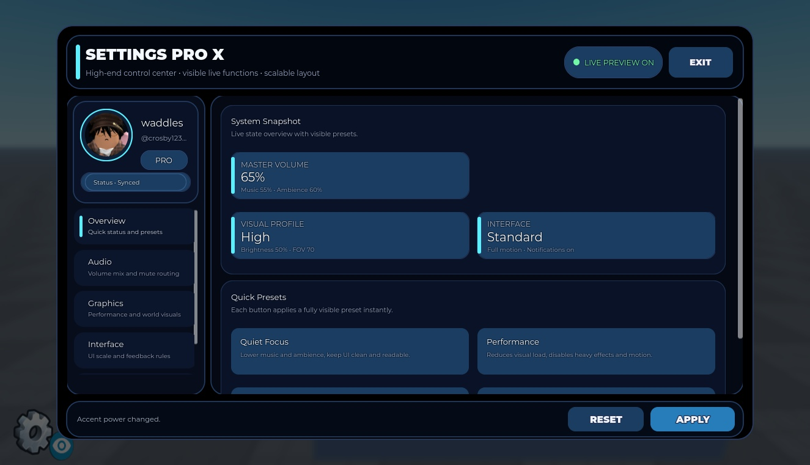

# Advanced Settings UI V1.6

Runtime-built settings interface with theme/font choices, audio controls, visual options and accessibility preferences.

**Preview release 0.1.0.** Original runtime-generated layout retained. Local visual/audio preference handling is not proof of persistent settings or game-wide integration. Mobile/gamepad testing remains unverified. Known supplied-code bug: click-sound callback calls a nil playClickSound function at line 291. Tabs render, but this is not a fully working release.

## Download

[Download Settings GUI ADVANCED V1.6.rbxm](Settings%20GUI%20ADVANCED%20V1.6.rbxm?raw=1) — 33,869 bytes.

[Full gallery — 9 screenshots](GALLERY.md) | [Native inventory](INVENTORY.md) | [Verification](VERIFICATION.md)

## Included assets

Runtime-built settings interface with theme/font choices, audio controls, visual options and accessibility preferences.

3 embedded scripts are extracted verbatim in [src/manifest.json](src/manifest.json). The binary is authoritative; do not install duplicate extracted copies.

## Installation

Move SettingsUi ScreenGui from Settings Panel into StarterGui. Keep SettingsButton and all embedded LocalScripts. ThumbnailCamera is a preview helper. Configure the main Settings script and wire any game-specific preferences to your own systems; review SoundService group names before use.

## Customization and dependencies

Work on a copy in Studio. Preserve required internal hierarchy, attachments, bones and relative transforms. Inspect [asset references](ASSET-REFERENCES.json); their availability in this Studio session does not guarantee permission in your destination experience. Keep original creator notices.

## Verification and limitations

Limited Studio Play check: original LocalScript generated the interface; overview/audio/graphics/interface/style tabs were visited. Top and bottom scroll states are captured. Known supplied-code error: Settings line 291 calls playClickSound as a nil value on clicks (function scoping/order issue). Navigation still displayed, but the pack must not be represented as fully working. No code repair was requested or applied.

Original runtime-generated layout retained. Local visual/audio preference handling is not proof of persistent settings or game-wide integration. Mobile/gamepad testing remains unverified. Known supplied-code bug: click-sound callback calls a nil playClickSound function at line 291. Tabs render, but this is not a fully working release.

SHA-256: `5e8a7e9abf36f31bc1b7cd79dc76f86396935ed597aa871d514f101d3c78fd6c`

## Credits and license

[Credits](CREDITS.md) | [Scoped project MIT notice](LICENSE) | [Repository scope](../../../docs/LICENSING.md) | [Changelog](CHANGELOG.md)

[Back to category](../README.md)
