# Brainrot HUD UI — gallery

Actual Studio captures of the supplied instances. Preview-only framing, anchoring, GUI visibility/scale/position changes are not changes to the native download.

### Hud Index Bottom — layout

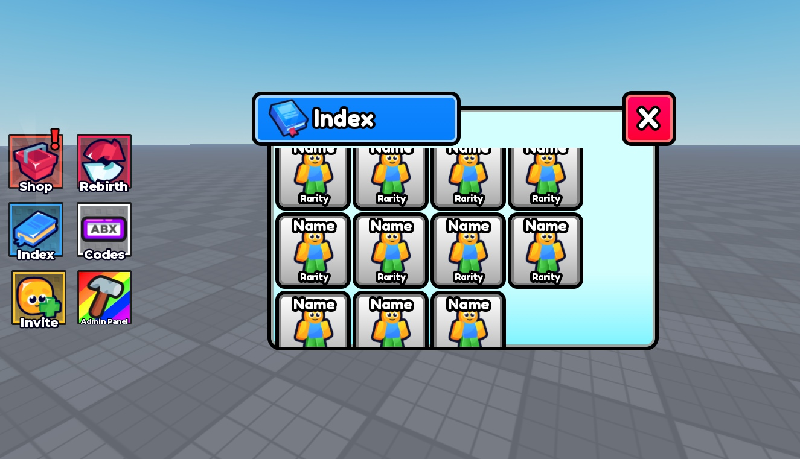

### Hud Index Settings — layout

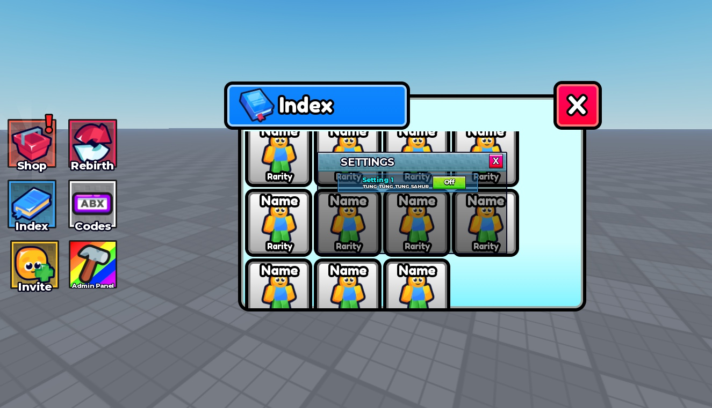

### Hud Index — layout

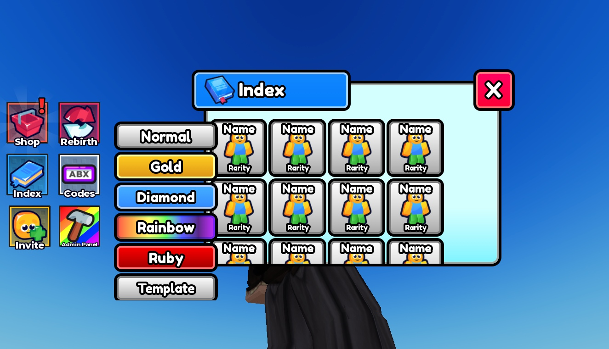

### Hud Main — layout

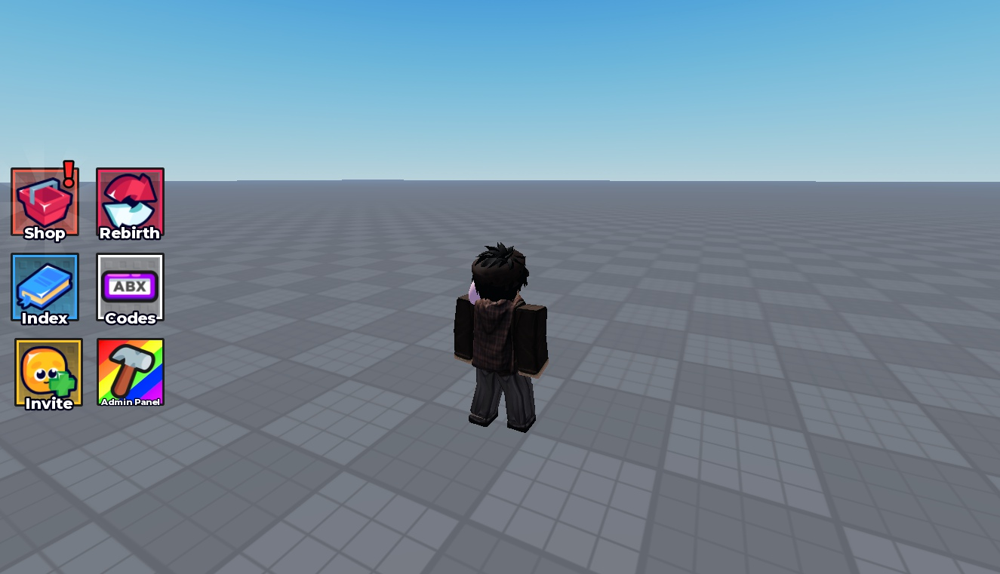

### Hud Rebirth — layout

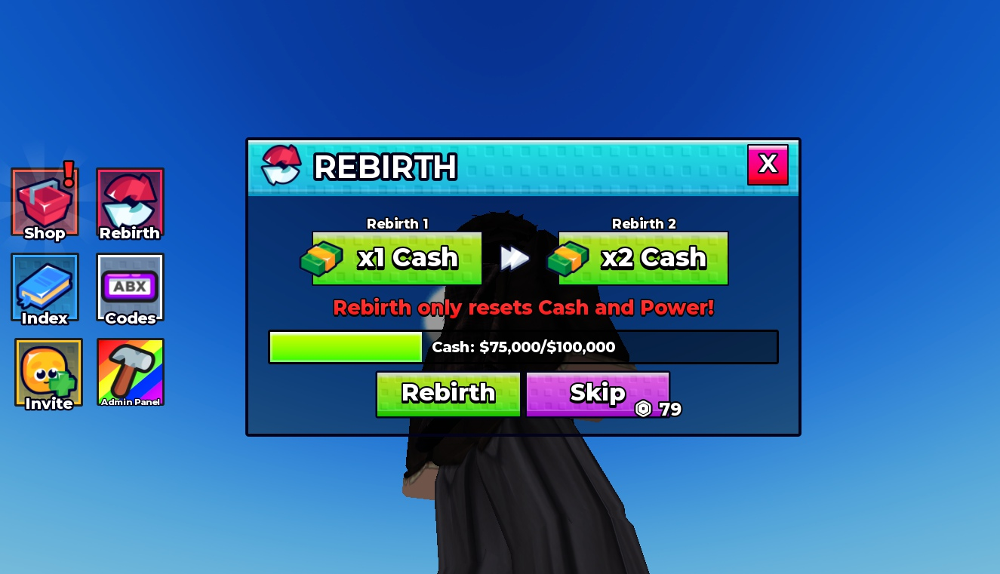

### Hud Shop 1 — layout

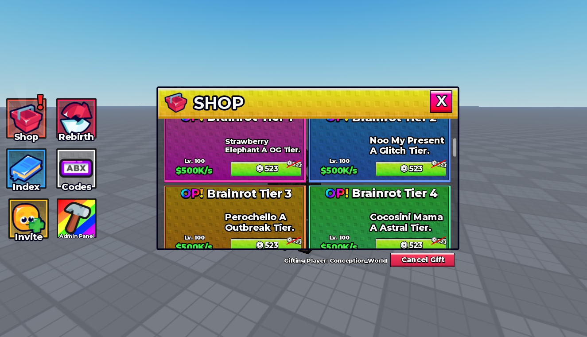

### Hud Shop 2 — layout

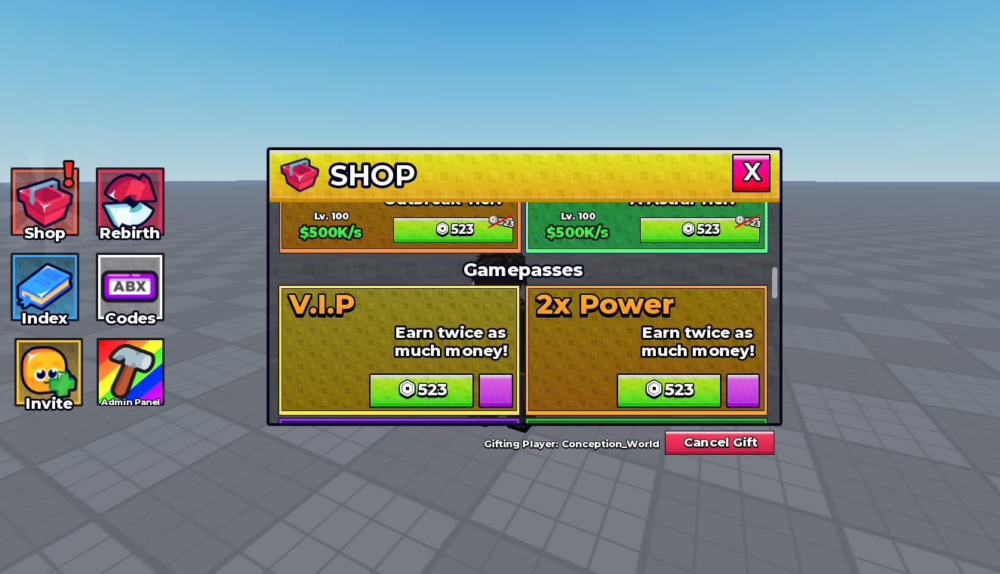

### Hud Shop 3 — layout

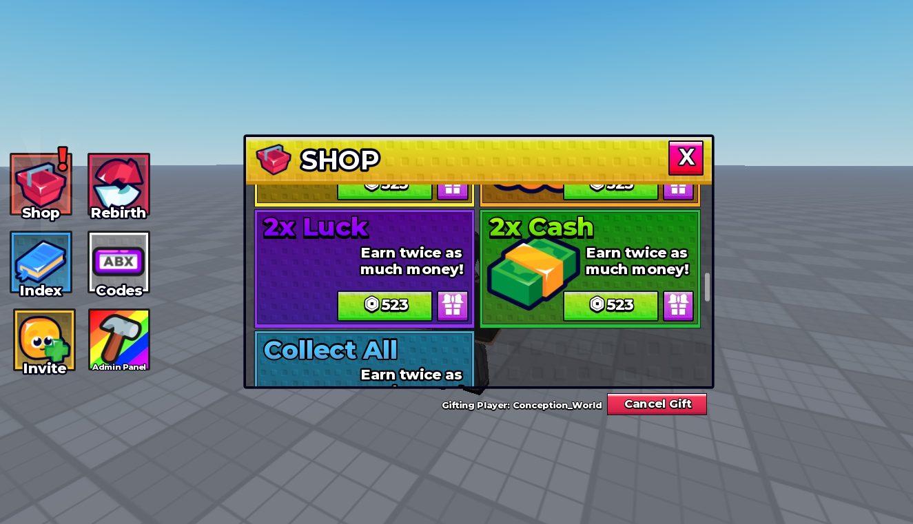

### Hud Shop 4 — layout

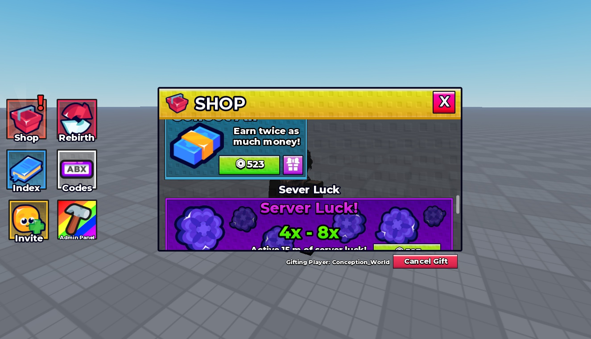

### Hud Shop 5 — layout

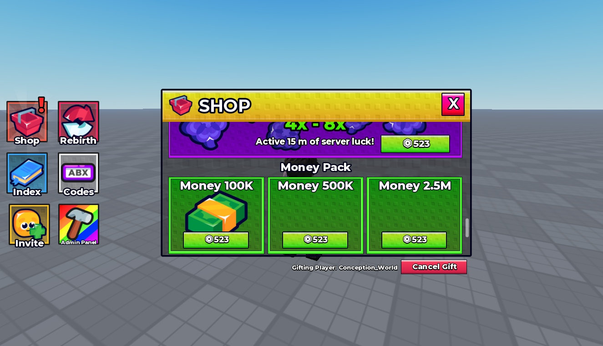

### Hud Shop 6 — layout

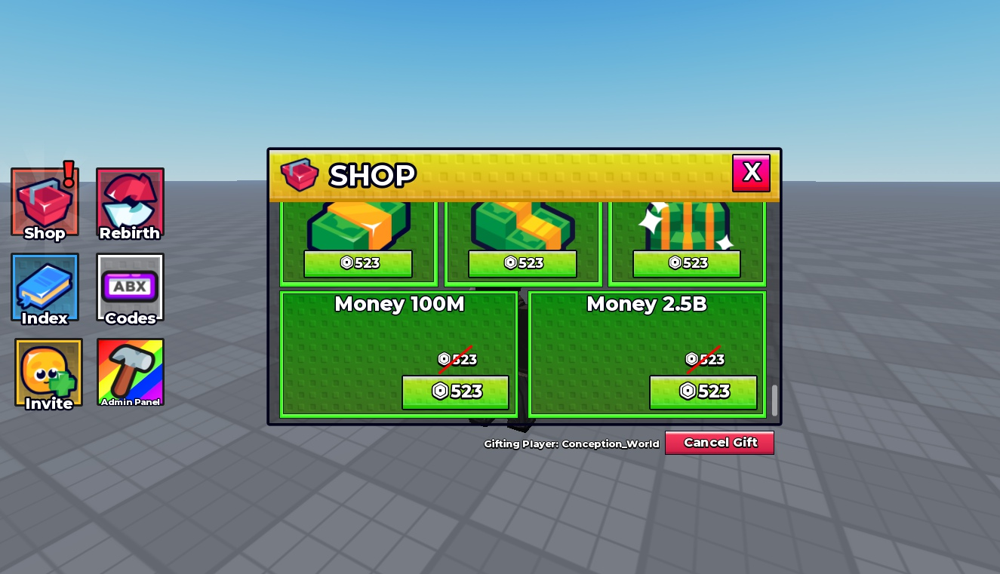

### Hud Shop — layout

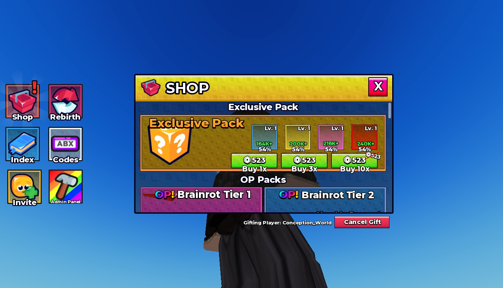

