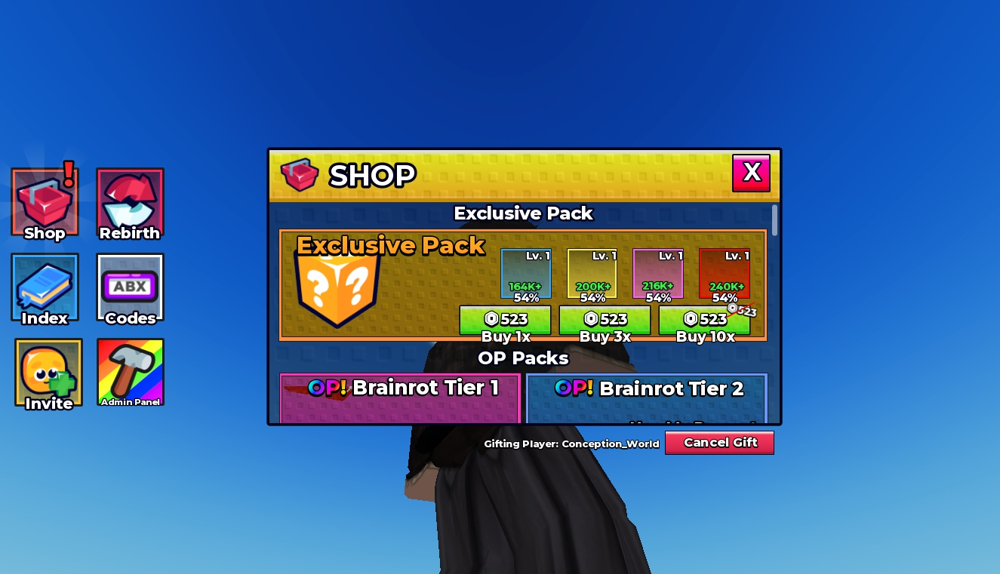

# Brainrot HUD UI

Editable HUD with six sidebar buttons, rebirth panel, scrollable shop, collection index, mutation list and index settings. Shop prices, player names and collection cards are sample layout content, not connected purchases or player data.

**Preview release 0.1.0.** Static layout inspected in Studio Play on temporary clones at 1325 x 761; panel visibility and scroll positions were set manually. No gameplay handlers are included. No mobile/gamepad testing. Native files are unchanged. Codes, Invite and Admin Panel are buttons only; there are no corresponding working systems. The Afk label is transparent in its supplied styling.

## Download

[Download hud.rbxm](hud.rbxm?raw=1) — 76,611 bytes.

[Full gallery — 12 screenshots](GALLERY.md) | [Native inventory](INVENTORY.md) | [Verification](VERIFICATION.md)

## Included assets

Editable HUD with six sidebar buttons, rebirth panel, scrollable shop, collection index, mutation list and index settings. Shop prices, player names and collection cards are sample layout content, not connected purchases or player data.

No embedded scripts were found.

## Installation

Insert the native HUD ScreenGui into StarterGui. Keep HUD, Interfaces and Afk descendants together. Add your own panel navigation, collection data, code redemption, invite and admin authorization logic. Implement purchases, rebirth and currency on the server; the sample labels are not an economy.

## Customization and dependencies

Work on a copy in Studio. Preserve required internal hierarchy, attachments, bones and relative transforms. Inspect [asset references](ASSET-REFERENCES.json); their availability in this Studio session does not guarantee permission in your destination experience. Keep original creator notices.

## Verification and limitations

Static layout preview in Studio Play on temporary clones; no original scripts are present. Panel visibility and scrolling were set manually, not by working navigation. Native instance counts/root names matched the supplied imports. Viewport 1325 x 761; desktop only.

Static layout inspected in Studio Play on temporary clones at 1325 x 761; panel visibility and scroll positions were set manually. No gameplay handlers are included. No mobile/gamepad testing. Native files are unchanged. Codes, Invite and Admin Panel are buttons only; there are no corresponding working systems. The Afk label is transparent in its supplied styling.

SHA-256: `fa8944c7018f9fa8ec5a87061cec6227b99f04fd84e4767a04f6623113f3603c`

## Credits and license

[Credits](CREDITS.md) | [Scoped project MIT notice](LICENSE) | [Repository scope](../../../docs/LICENSING.md) | [Changelog](CHANGELOG.md)

[Back to category](../README.md)
