# Command HQ — Roblox HUD & Interface Pack

**Editable glass UI kit · 6 panels + notifications · generated Settings icons · PC/mobile top-right HUD · 0.3.0 draft**

[**Download CommandHQ.rbxm**](CommandHQ.rbxm?raw=1) · [Screenshot gallery](#screenshot-gallery) · [Asset credits](CREDITS.md)

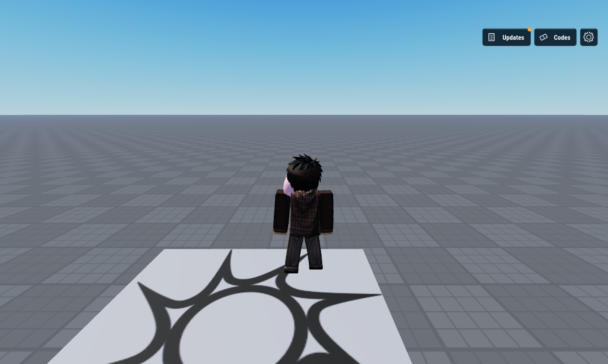

## Drag-and-drop setup

1. Download [CommandHQ.rbxm](CommandHQ.rbxm?raw=1).
2. Stop Play in Roblox Studio.
3. Right-click **StarterGui → Insert from File**, then select the model. Alternatively import it, then move the CommandHQ ScreenGui into StarterGui.
4. Press Play. Panels start closed; Updates, Codes and Settings open from the top right. On touch devices and narrow windows the toolbar becomes icon-only.

The native model already contains all editable UI and its controller. No code loader, extra plugin or manual script placement is needed.

```text
StarterGui
└── CommandHQ (ScreenGui)
    ├── Controller (LocalScript)
    ├── HUD
    │   ├── TopRight (Updates, Codes, Settings, unread badge)
    │   └── Notifications (success, invitation, error)
    └── Panels
        ├── Settings (Audio, Game, Graphics, Controls)
        ├── UpdateLog
        ├── RedeemCode
        ├── Missions
        ├── LeaveQueue
        └── PurchaseUnit
```

## Customize directly in Studio

Select named text, frames, borders and icon parts to change the design. The 0.3.0 revision applies 49 separately sampled reference color roles: panels, headers, rims, dividers, slider parts, neutral tabs, selected tabs, action buttons and toggles. Opaque navy paint matches the sampled composited reference surfaces; a separate Gaussian alpha image supplies the soft shadow. The gold header ribbon meets the top and left edges. Four generated Settings icons replace the earlier geometric placeholders. Preview a panel by enabling its Visible property under Panels; hide it again before saving. Notifications has its own Visible property under HUD. The initial editable model is complete with scripts disabled; Play runs only behavior and responsive layout.

The controller adapts to the usable GUI size, reflows narrow Settings rows and Code entry, and scrolls long Settings, Updates and Missions content. Edit-mode panel sizes are authoring dimensions; change ResponsiveScale for a temporary preview, then let the controller recompute in Play.

Audio sliders and toggles hold local UI state. They do not control your game's SoundGroups. Game and Graphics now contain sample toggles and quality buttons; Controls contains styled key-binding buttons. These are demonstration controls and do not alter gameplay, rendering settings or actual key bindings. No sounds, data saving, economy, actual queue, purchase or reward system is included. The demonstration redemption code is **HQ140**, once per session.

Missions and the two confirmation panels have no invented HUD launchers. Preview them in Edit mode, or fire the runtime `CommandHQ.OpenPanel` BindableEvent from a LocalScript with `Missions`, `LeaveQueue` or `PurchaseUnit`. Fire it with nil to close. Connect your own server systems for production behavior. Notifications are three sample alerts, not real party or deployment events.

## Screenshot gallery

Actual Roblox Studio MCP captures of the imported native model in Play. The baseplate and avatar are a preview environment and are not included. All gallery images show the final 0.3.0 imported model. Background blur is active in panel captures; the preview world is not bundled.

| Audio settings | Game settings |
| --- | --- |
| 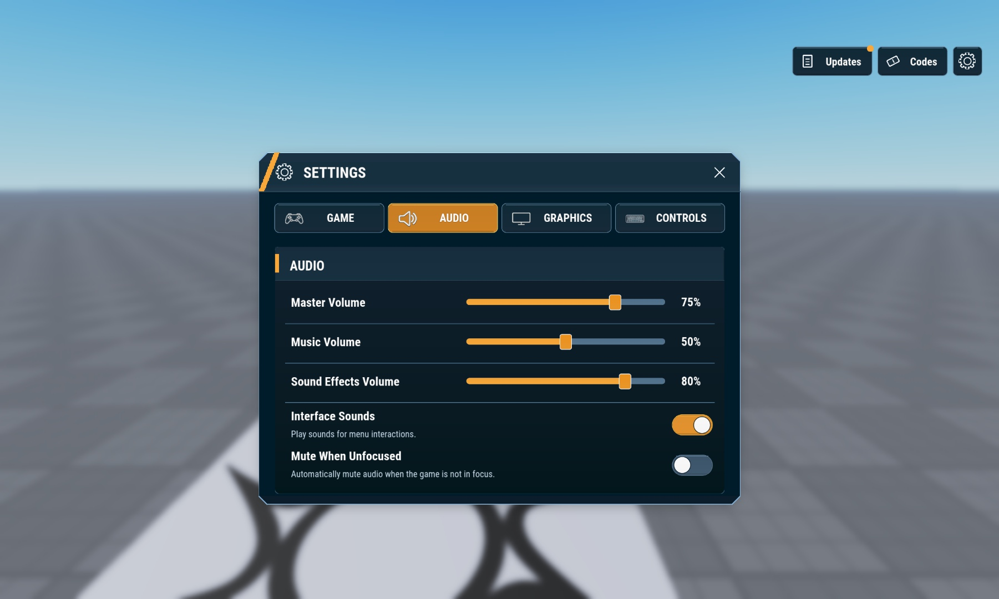 | 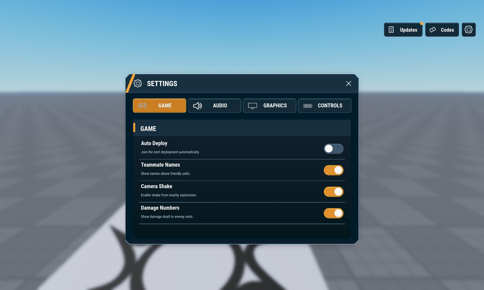 |

| Graphics settings | Controls |
| --- | --- |
| 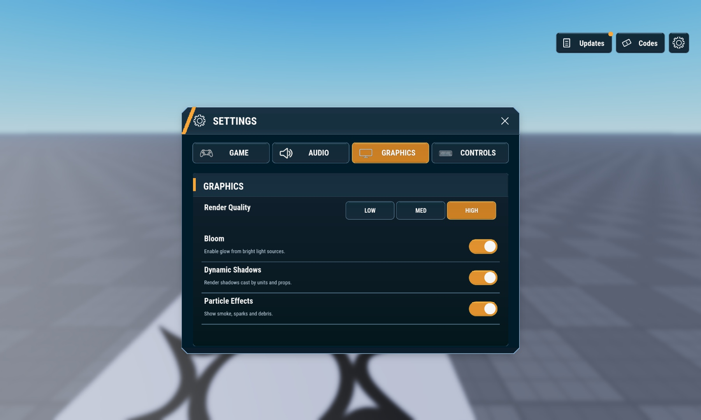 | 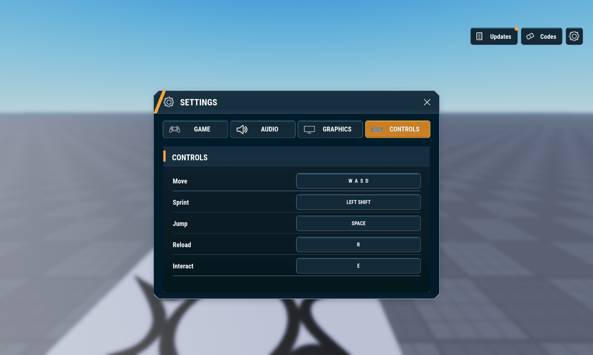 |

| Update log | Redeem code |
| --- | --- |
| 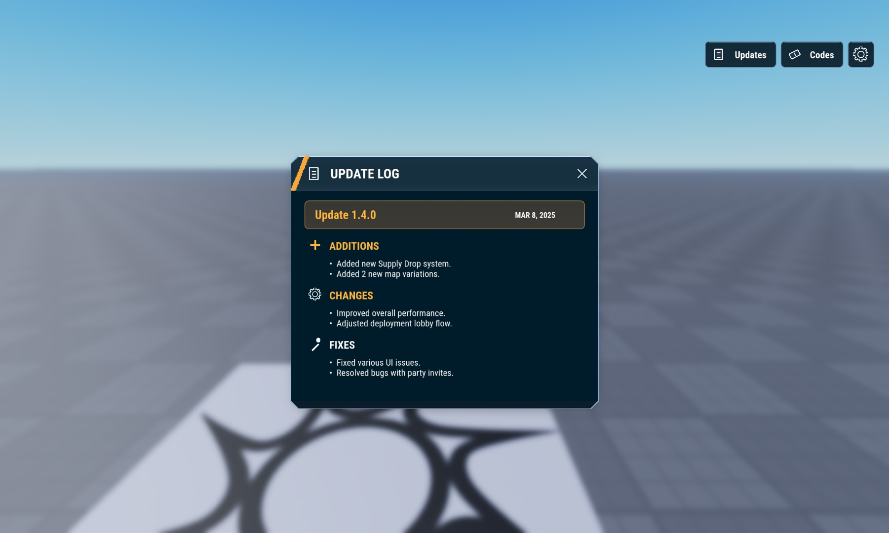 | 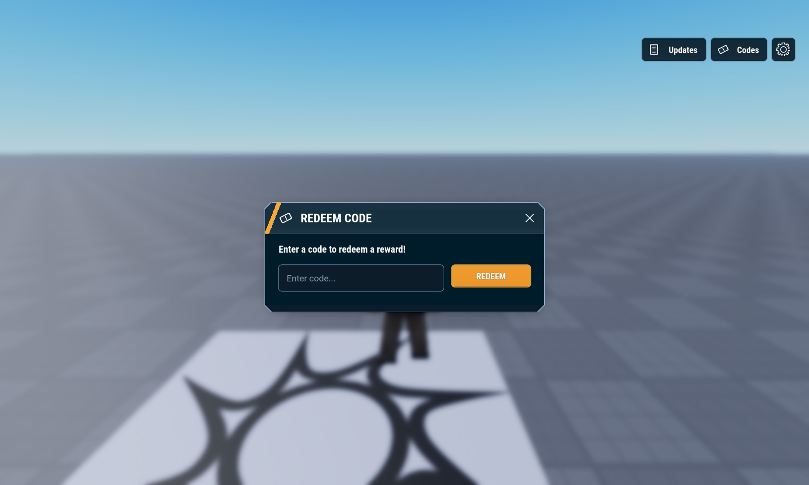 |

| Tasks & missions | Leave queue |
| --- | --- |
| 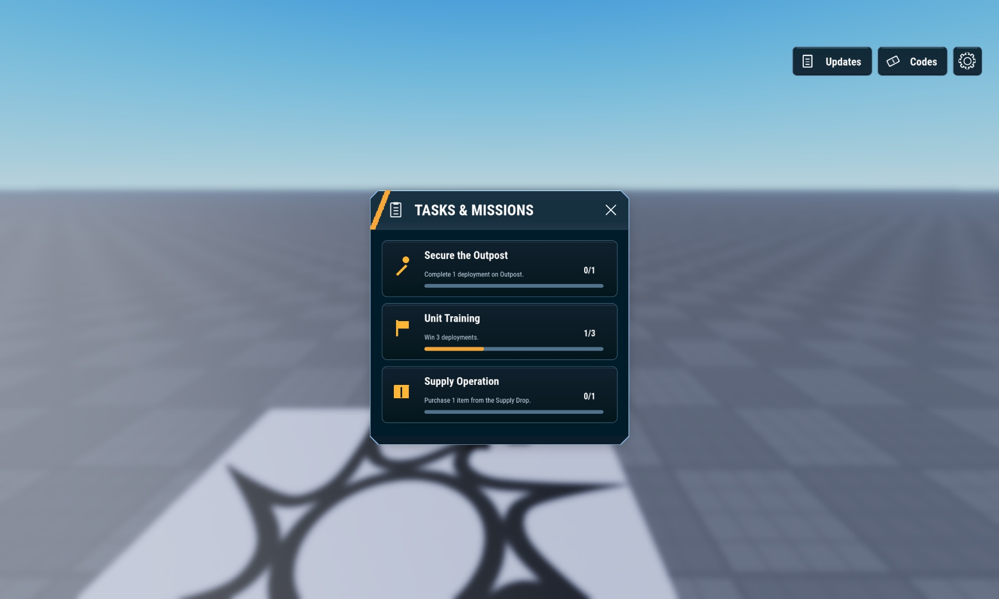 | 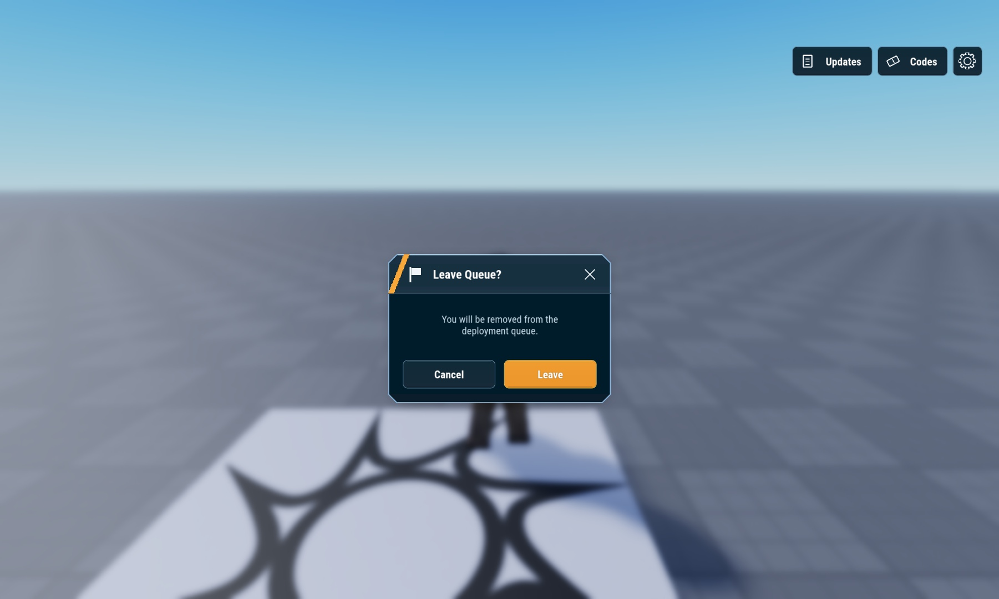 |

| Purchase unit | Notifications |
| --- | --- |
| 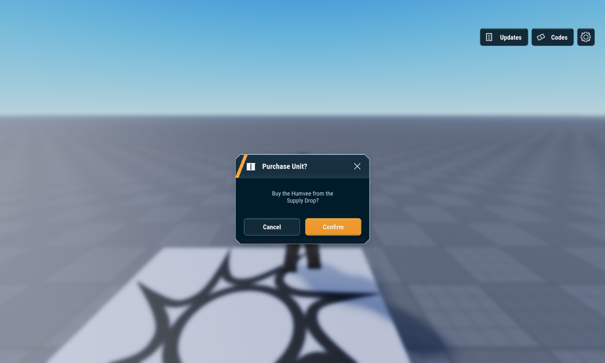 | 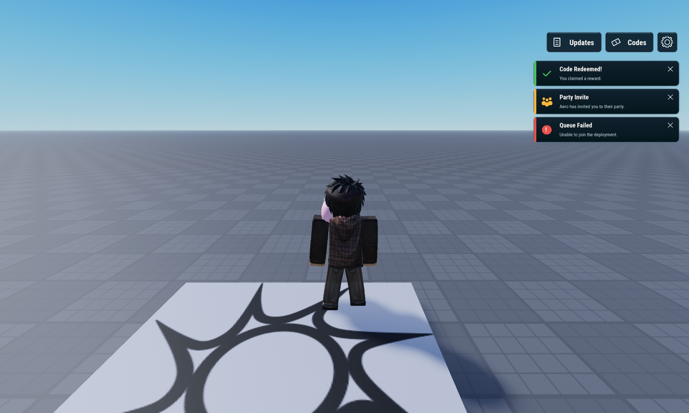 |

### Mobile toolbar

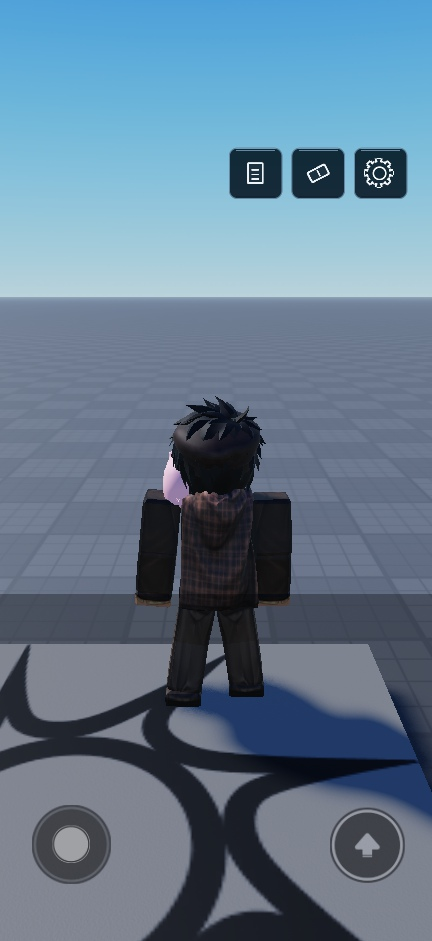

## What's in this folder?

```text
command-hq/
├── README.md
├── CommandHQ.rbxm          # Native editable model
├── src/                   # Build, Polish, Controller, Theme and Assets sources
├── assets/                # Generated icons, real IDs, prompts and notes
├── previews/              # HUD, every panel/tab, device evidence
├── exports/               # Checksums and raw device measurements
├── pack.json
├── CREDITS.md
└── VERIFICATION.md
```

## Dependencies and verification

Four uploaded generated image icons and one procedural shadow image are required; IDs and source PNGs are included in assets/. No sound or third-party code dependencies. The model contains 2,320 descendants, an embedded controller, Assets, Theme and Palette modules, and a blur template. Studio serialization/deserialization and imported Play checks passed. Desktop mouse interactions, native scrolling, phone/tablet layout and live orientation changes were exercised. [VERIFICATION.md](VERIFICATION.md) records actual dimensions and limitations.

Touch gestures, virtual keyboards, physical devices, gamepad navigation, TV overscan and couch-distance readability are unverified. Console captures establish geometry only. Nineteen requested viewport/profile cases were captured for every panel and all four Settings tabs. Breakpoint boundary probing and exhaustive touch/keyboard/gamepad checks remain incomplete. Treat this as a tested draft, not complete all-device acceptance.

**Draft.** Original Steal a Template contributions use the included [MIT license](LICENSE). Reference designs and external platform assets retain their own rights; see [credits](CREDITS.md).

<details>
<summary>For pack maintainers: source builds and checks</summary>

Run src/Build.luau through Studio MCP in Edit mode after preserving an existing root. Use a temporary disabled CommandHQ_Revision root. Embed Assets, Palette and Theme from src/ as ModuleScripts before requiring Theme, and Controller as a LocalScript. Run Polish.luau once, then ColorMatch.luau. These are authoring steps; the runtime controller does not reconstruct the UI. Validate before swapping into place.

Export with SerializationService, import the resulting native bytes, and recheck Play behavior, every panel/tab gallery, asset loading and the device matrix after changes. Update `exports/native-export.json` and metadata. Do not overwrite user customizations or distribute a stale model.

No repo-wide build/test command exists. Packaging was checked for native RBXM signature, file/link existence, image decoding, gallery/metadata agreement and source/model checksums.

</details>
