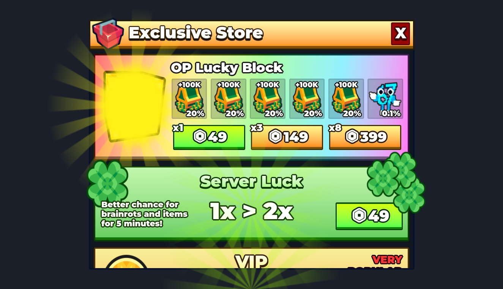
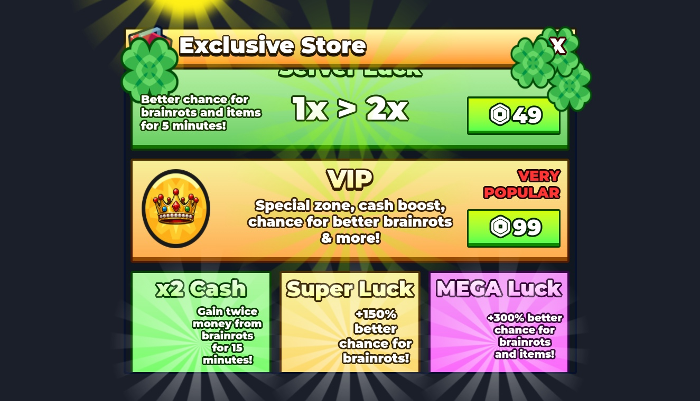
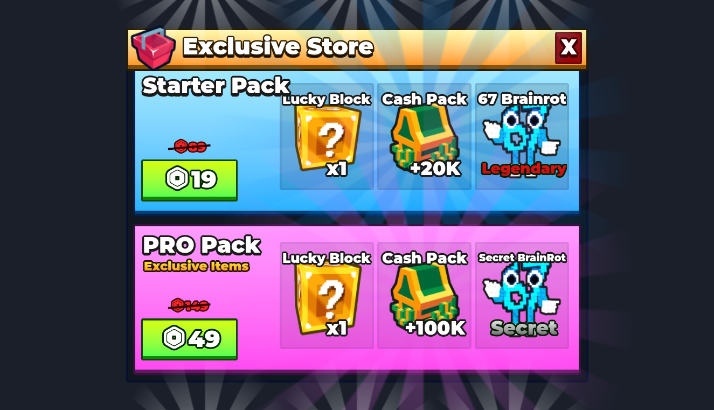
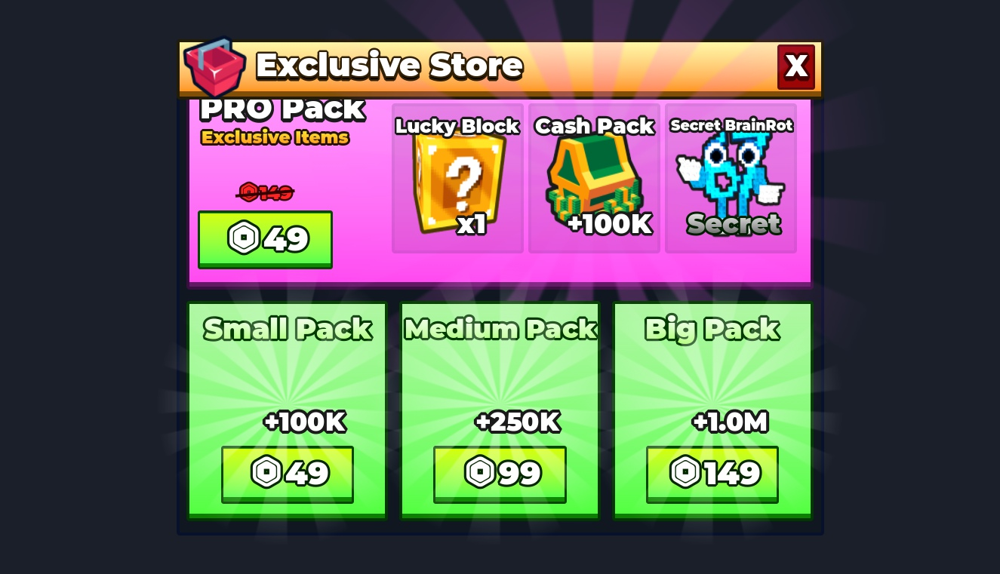

# Custom Store UI / Gallery

Actual Studio Edit-mode captures of the delivered instances, isolated on temporary preview clones. Scale is normalized per model; these are not common-scale comparisons. Original files are unchanged. Effects/labels may be hidden only on preview clones. See [verification](VERIFICATION.md).

## 1. Store scroll position 0

## 2. Store scroll position 350

## 3. Store scroll position 700

## 4. Store scroll position 1050

## 5. Store scroll position 1362

