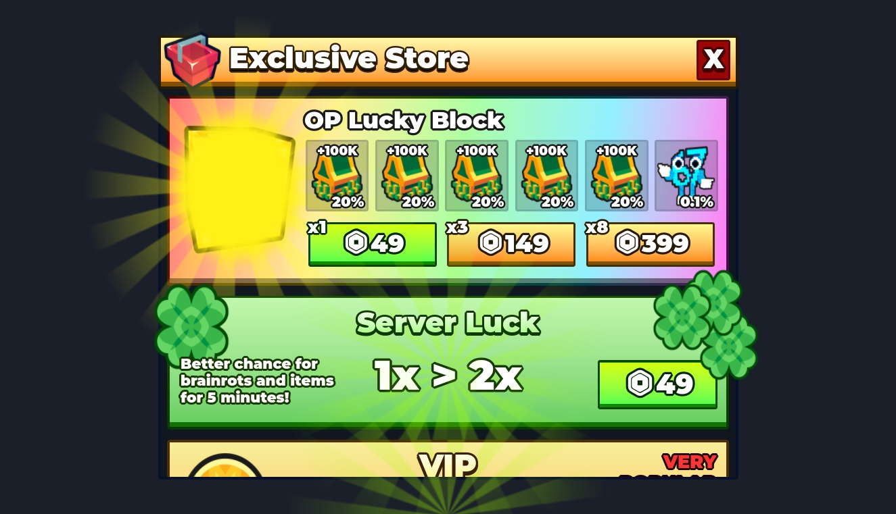

# Custom Store UI

Editable store with cash packs, server luck, VIP, starter/pro packs, passes and lucky-block offers.

**Preview release 0.1.0.** Presentation preview only. Missing game-specific dependencies prevent a standalone working store. Purchase prompts are not fulfillment; original product IDs are not your products. No purchases or supplied scripts were executed for capture; scrolling/device/runtime behavior remains unverified.

## Download

[Download Custom Gui.rbxm](Custom%20Gui.rbxm?raw=1) - native Roblox model, 43,662 bytes.

[Full gallery - 5 screenshots](GALLERY.md) | [Included entries](INVENTORY.md) | [Verification](VERIFICATION.md)

## Included assets

Editable store with cash packs, server luck, VIP, starter/pro packs, passes and lucky-block offers.

See the [native inventory](INVENTORY.md) for original entry names and instance counts. All supplied descendants and original source notices are retained. 2 embedded scripts are also extracted verbatim under [src/](src/manifest.json); the native binary remains authoritative. Do not install both extracted copies and embedded scripts.

## Installation

Stop Play. Create a ScreenGui in StarterGui and import/move the Store Frame beneath it. Store is a Frame, not a ScreenGui. Set ScreenGui.ResetOnSpawn and insets for your experience. Inspect both StoreHandler and StoreHandler_OLD and keep at most the intended handler enabled. The supplied handlers depend on ReplicatedStorage.Sounds.EpicPromptSound; the newer handler also needs BrainrotsModule, RaritiesModule and Remotes.NotifsEvent. Replace all developer-product/gamepass IDs before enabling purchase code, and implement authoritative receipt/entitlement handling on the server.

## Customization and dependencies

Duplicate a master before editing. Customize native instances in Roblox Studio rather than flattening them into an image. Preserve internal rig, constraint, mesh and appearance references. Linked Roblox-hosted content may need permission in your destination experience; the [asset reference inventory](ASSET-REFERENCES.json) is not an access guarantee. No external asset payloads are bundled beyond the original model.

## Verification and limitations

Presentation preview only. Missing game-specific dependencies prevent a standalone working store. Purchase prompts are not fulfillment; original product IDs are not your products. No purchases or supplied scripts were executed for capture; scrolling/device/runtime behavior remains unverified.

[Read scoped verification](VERIFICATION.md). The original download is byte-for-byte preserved; preview-only normalization, anchoring and effect/label visibility changes do not alter the delivered asset.

SHA-256: `72584b5fa51bf57c83ea896340219b47a4c4a0b883f43c52b1151e75621e4b88`

## Credits and license

[Credits and source provenance](CREDITS.md) | [MIT notice with limited project scope](LICENSE) | [Repository licensing](../../../docs/LICENSING.md). Existing third-party terms remain in effect; this listing does not establish original authorship.

[Changelog](CHANGELOG.md) | [Back to category](../README.md)
