# Steal a Template / Essential STUD UI - Roblox HUD & Interface Pack

**Editable Roblox UI kit · 9 panels · animated items and effects**

[**Download EssentialStudUI.rbxm**](EssentialStudUI.rbxm?raw=1) · [Screenshot gallery](#screenshot-gallery)

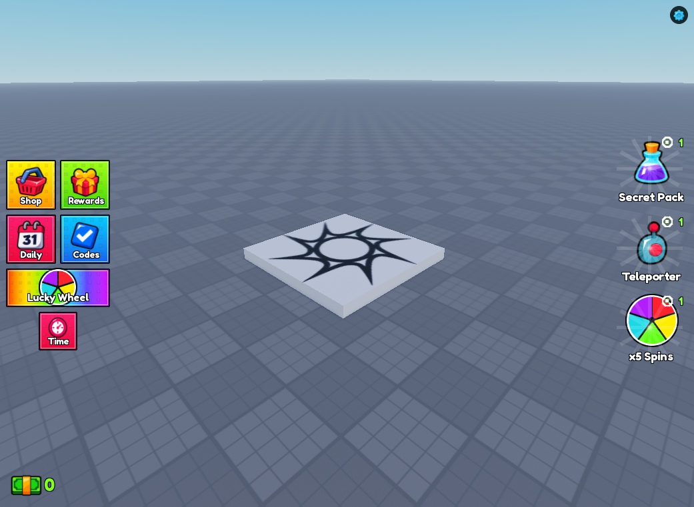

## Drag-and-drop setup

1. Download **[EssentialStudUI.rbxm](EssentialStudUI.rbxm?raw=1)**. You do not need the whole repository.
2. Stop Play in Roblox Studio and open **Explorer**.
3. Right-click **StarterGui → Insert from File** and select the model.
4. If it imports elsewhere, move the **EssentialStudUI** ScreenGui into **StarterGui**.
5. Press **Play**. The controller is included; no code paste or plugin is needed. Import only one copy.

## Included

Shop, gifting and confirmation, group rewards, daily rewards, playtime rewards, codes, lucky wheel, settings, and loading screen. Includes item bob/rock motion, rotating rays, cycling offers, panel transitions, hover/press feedback, confetti, notifications, and cash effects.

## Customize directly in Studio

- **Panels:** under `Canvas > Panels`, enable a panel's `Visible` property to preview it. Hide it again before saving.
- **Artwork/text/colors:** edit the named native instances. Source atlases are in `assets/`.
- **Demo settings:** edit `Configuration` for starting cash/spins, offer timing, codes and reward timers.
- **Behavior:** edit the included `Runtime`; `Controller` starts it automatically.
- **Scaling:** runtime fits the canvas to the viewport. `Canvas.ViewportScale` controls Edit-mode preview only. Portrait-phone layouts need further adaptation for readable text.
- **Audio:** sliders control `EssentialMusic` and `EssentialSFX` SoundGroups if supplied. No audio files are included.

**Purchases, gifts, currency and rewards are local demos. No Robux is charged and progress is not saved.** Connect server-authoritative systems before production use.

## Screenshot gallery

Studio captures of the kit; the baseplate environment is not included.

| Limited-time shop | Gamepasses |
| --- | --- |
| 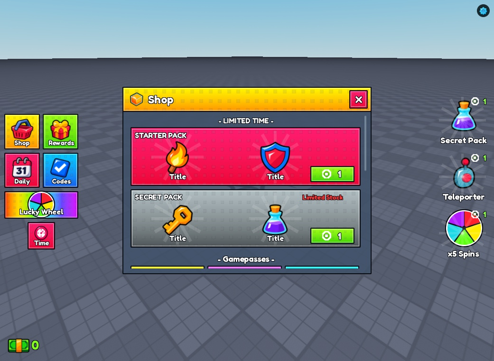 | 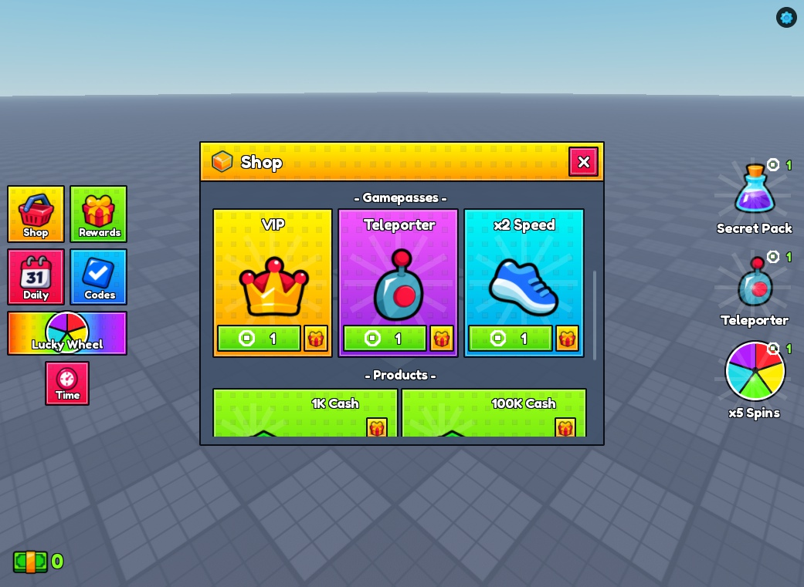 |

| Cash products | Gift recipients |
| --- | --- |
| 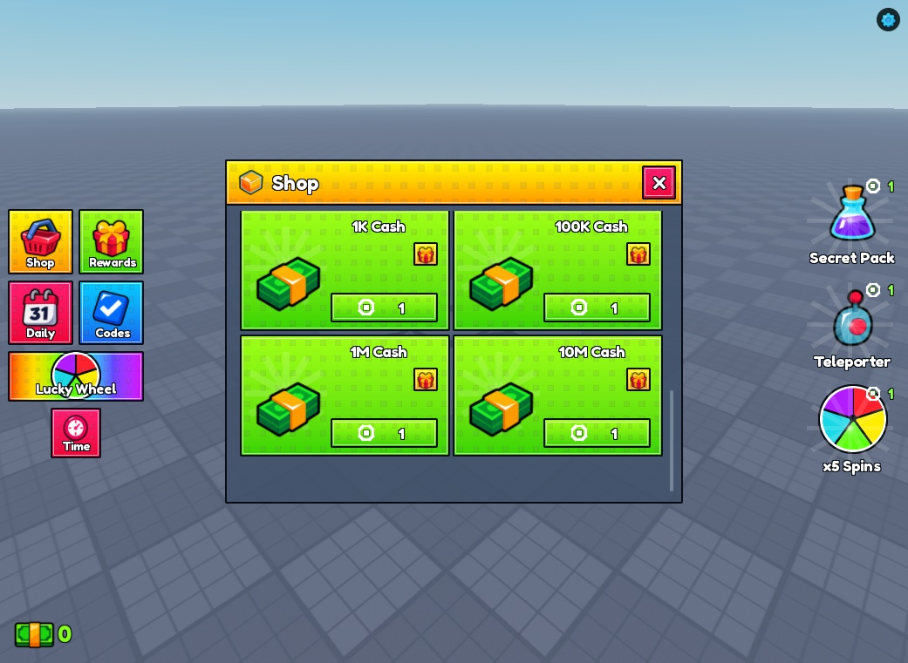 | 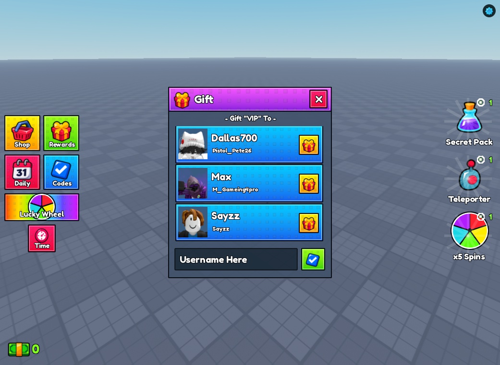 |

| Gift confirmation | Group rewards |
| --- | --- |
| 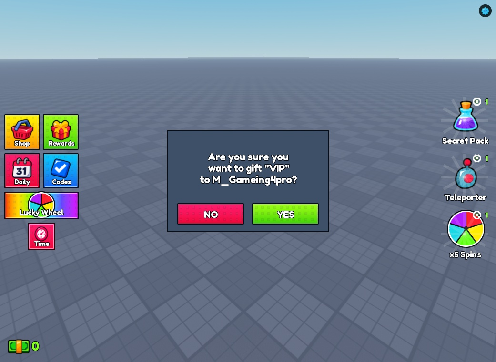 | 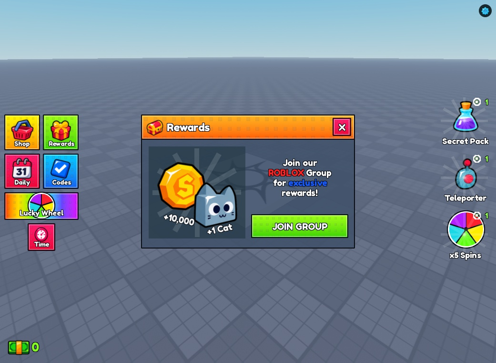 |

| Daily rewards | Playtime rewards |
| --- | --- |
| 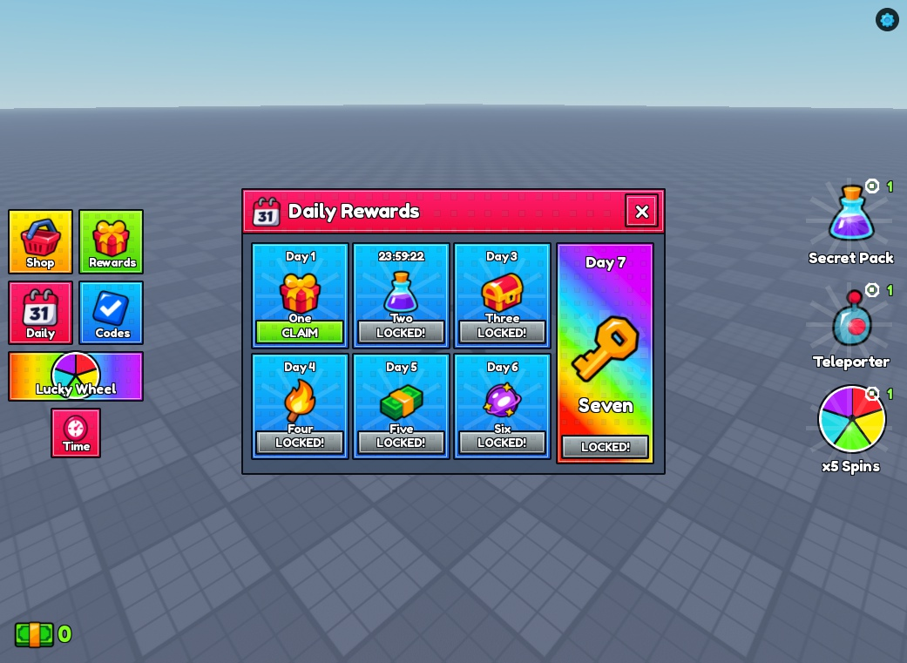 | 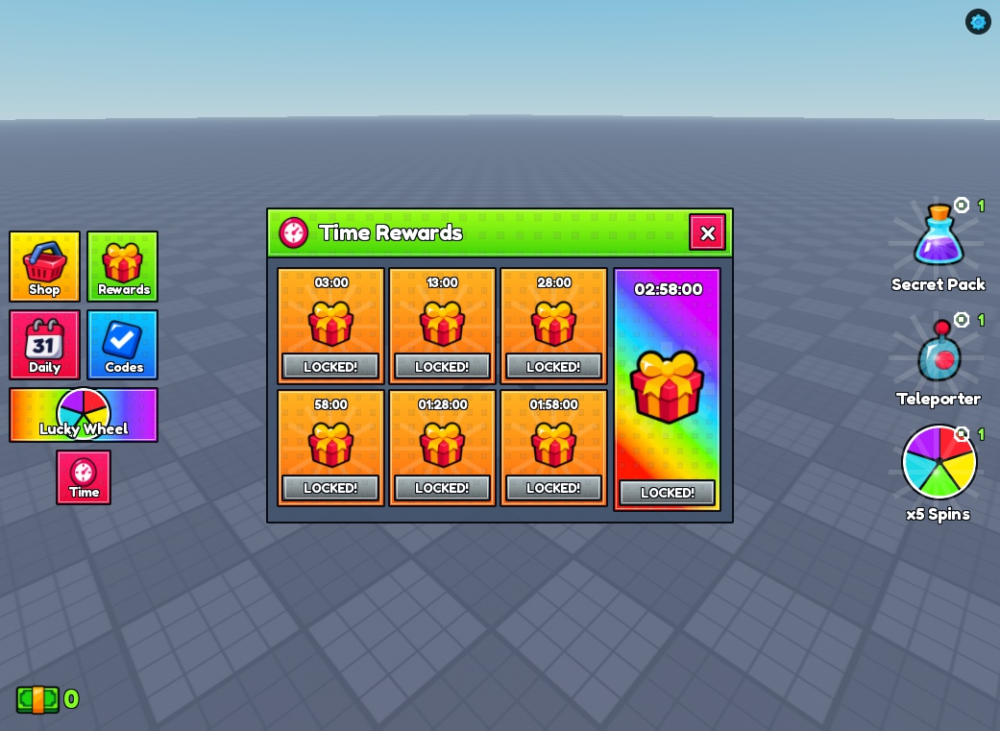 |

| Codes | Lucky wheel |
| --- | --- |
| 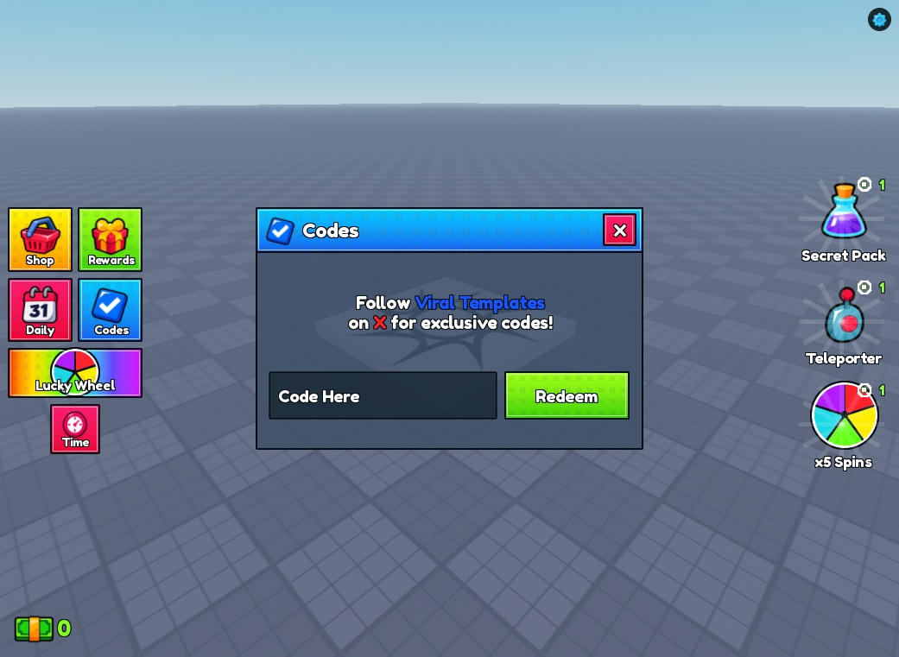 | 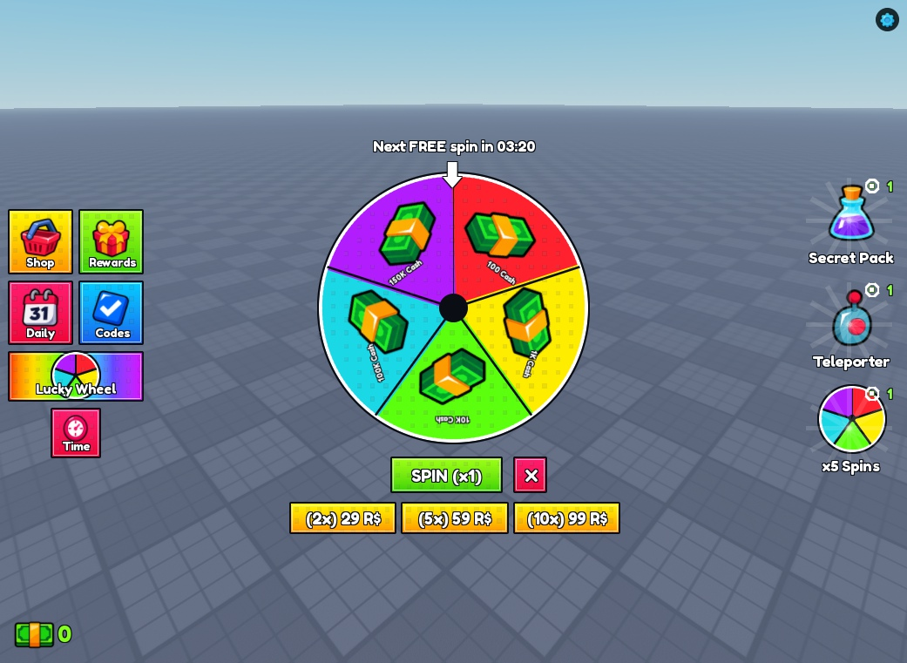 |

| Settings | Loading |
| --- | --- |
| 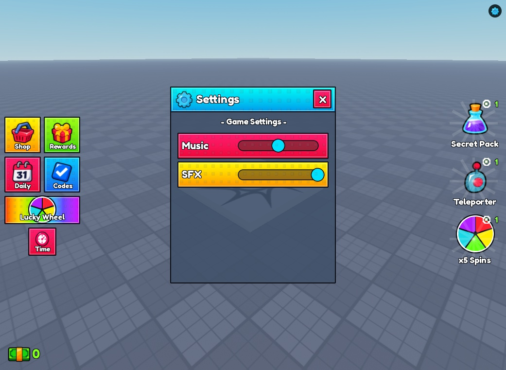 | 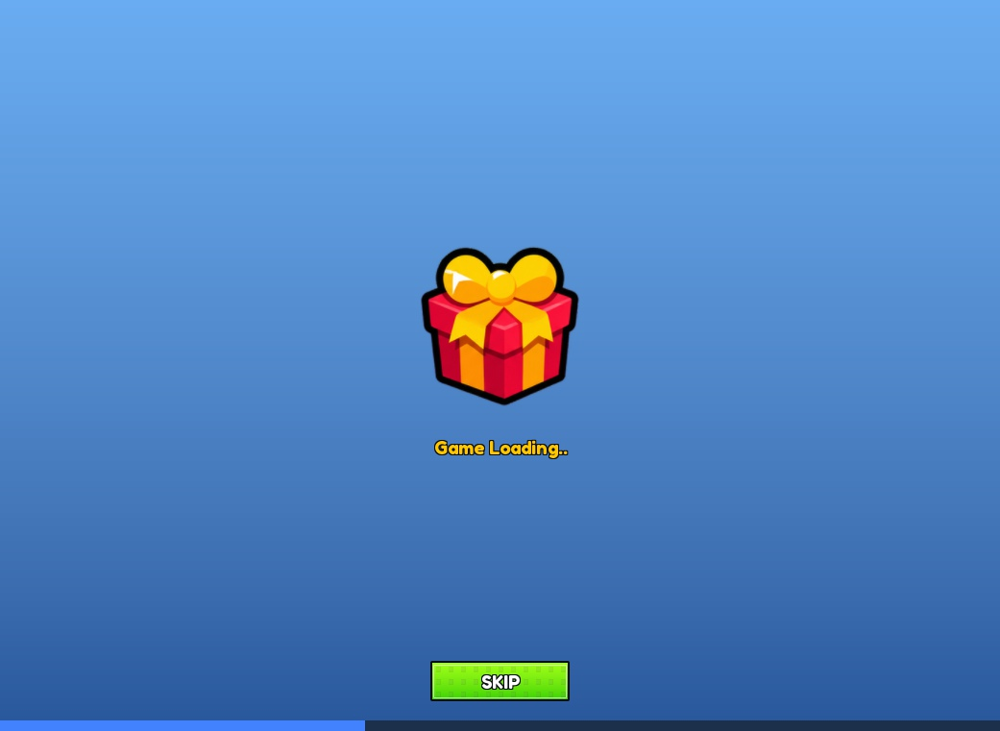 |

## Assets and use

Generated artwork and editable native geometry; no seller source files or reference media are bundled. Asset IDs and artwork provenance are in `assets/`. Verify Roblox asset access in your destination experience. Original Steal a Template contributions use the [MIT License](LICENSE). Generated artwork and motion are not an exact reproduction; reference-design permissions are recorded separately in the credits.

See [credits and permissions](CREDITS.md) for artwork records and license scope.
