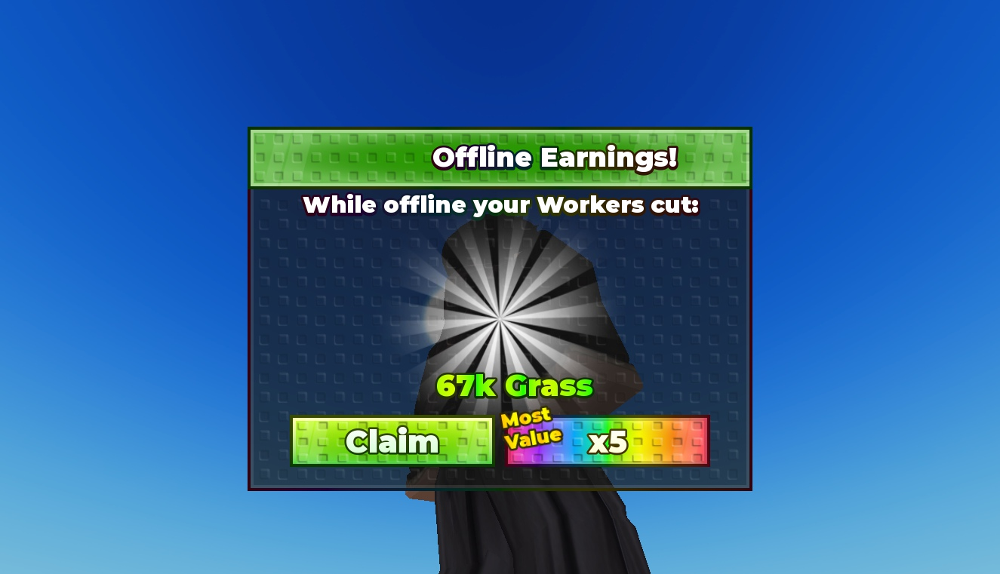

# Offline Earnings UI

Editable offline-earnings reward dialog with claim and x5 reward buttons, sample 67k Grass text, green stud styling and burst artwork.

**Preview release 0.1.0.** Static layout inspected in Studio Play on temporary clones at 1325 x 761; panel visibility and scroll positions were set manually. No gameplay handlers are included. No mobile/gamepad testing. Native files are unchanged. Displayed reward values are examples; claiming, multipliers and persistence are not implemented.

## Download

[Download Offline Earnings GUI - TU VIP.rbxm](Offline%20Earnings%20GUI%20-%20TU%20VIP.rbxm?raw=1) — 18,313 bytes.

[Full gallery — 1 screenshots](GALLERY.md) | [Native inventory](INVENTORY.md) | [Verification](VERIFICATION.md)

## Included assets

Editable offline-earnings reward dialog with claim and x5 reward buttons, sample 67k Grass text, green stud styling and burst artwork.

No embedded scripts were found.

## Installation

Create a ScreenGui under StarterGui and import OfflineEarnings inside it. Position the Frame for your layout; preview clones used AnchorPoint (0.5, 0.5) and Position (0.5, 0.5). Connect Claim and x5 controls to your own server-authoritative earnings and purchase logic. No offline tracking or saving is bundled.

## Customization and dependencies

Work on a copy in Studio. Preserve required internal hierarchy, attachments, bones and relative transforms. Inspect [asset references](ASSET-REFERENCES.json); their availability in this Studio session does not guarantee permission in your destination experience. Keep original creator notices.

## Verification and limitations

Static layout preview in Studio Play on temporary clones; no original scripts are present. Panel visibility and scrolling were set manually, not by working navigation. Native instance counts/root names matched the supplied imports. Viewport 1325 x 761; desktop only.

Static layout inspected in Studio Play on temporary clones at 1325 x 761; panel visibility and scroll positions were set manually. No gameplay handlers are included. No mobile/gamepad testing. Native files are unchanged. Displayed reward values are examples; claiming, multipliers and persistence are not implemented.

SHA-256: `fd93b6389dcd06b7832dcf56eac710cf9bc0288e3f0d24449346e12353815207`

## Credits and license

[Credits](CREDITS.md) | [Scoped project MIT notice](LICENSE) | [Repository scope](../../../docs/LICENSING.md) | [Changelog](CHANGELOG.md)

[Back to category](../README.md)
