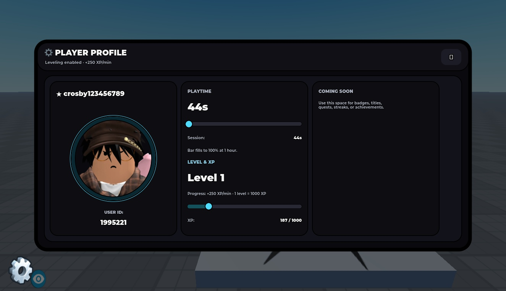

# Player Profile Card UI

Dark-tech player profile UI with avatar, username, user ID, session playtime and XP/level display.

**Preview release 0.1.0.** Original runtime-generated UI is preserved, not converted into a prebuilt editable panel. Default session XP/playtime are local demo values, not persistent authoritative progression. Mobile/gamepad and saved progression are unverified.

## Download

[Download Player Profile Card UI.rbxm](Player%20Profile%20Card%20UI.rbxm?raw=1) — 21,041 bytes.

[Full gallery — 1 screenshots](GALLERY.md) | [Native inventory](INVENTORY.md) | [Verification](VERIFICATION.md)

## Included assets

Dark-tech player profile UI with avatar, username, user ID, session playtime and XP/level display.

1 embedded scripts are extracted verbatim in [src/manifest.json](src/manifest.json). The binary is authoritative; do not install duplicate extracted copies.

## Installation

Import the folder into a staging location and move its PlayerCard ScreenGui into StarterGui. ThumbnailCamera is an authoring helper, not required gameplay. Keep PlayerCardButton and the embedded LocalScript. The panel is generated by that script at runtime. Configure STAT_SOURCE_MODE and leaderstat names if integrating server-backed statistics.

## Customization and dependencies

Work on a copy in Studio. Preserve required internal hierarchy, attachments, bones and relative transforms. Inspect [asset references](ASSET-REFERENCES.json); their availability in this Studio session does not guarantee permission in your destination experience. Keep original creator notices.

## Verification and limitations

Limited Studio Play check: original LocalScript generated the panel; opening and closing through its buttons succeeded, avatar loaded, and session playtime/XP advanced. Desktop viewport: 1325 x 761. No persistence or mobile/gamepad test.

Original runtime-generated UI is preserved, not converted into a prebuilt editable panel. Default session XP/playtime are local demo values, not persistent authoritative progression. Mobile/gamepad and saved progression are unverified.

SHA-256: `740c90ea51a74cbd3f42830bd375c8aa96011cb16fa1d96ff2c2c912fb566d56`

## Credits and license

[Credits](CREDITS.md) | [Scoped project MIT notice](LICENSE) | [Repository scope](../../../docs/LICENSING.md) | [Changelog](CHANGELOG.md)

[Back to category](../README.md)
