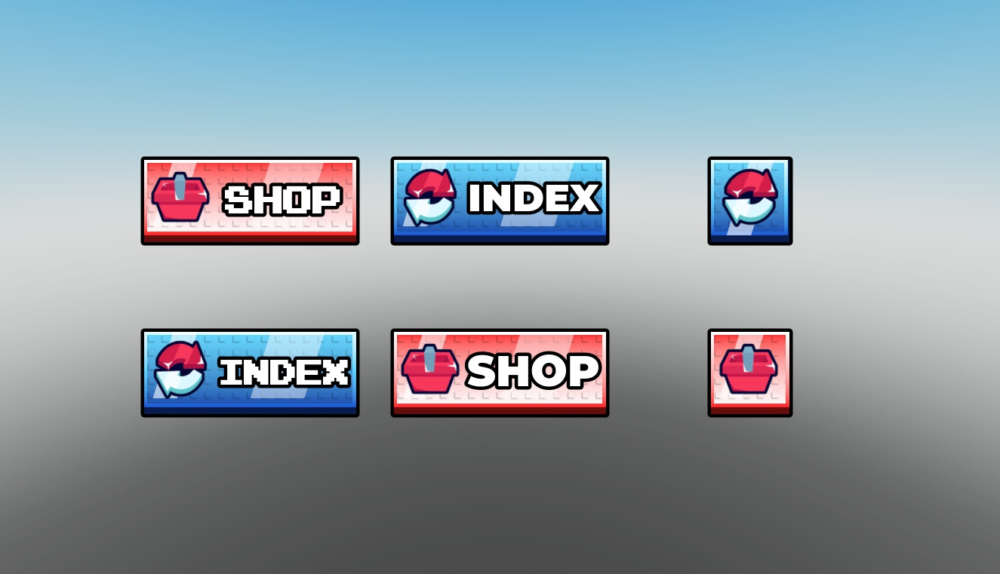

# Shop & Index UI Buttons

Six shop/index button variants with native editable GUI objects, hover effects and click-particle scripts.

**Preview release 0.1.0.** Button presentation/effects only. No shop catalog, purchase fulfillment or index backend is included. Mobile/gamepad behavior is unverified.

## Download

[Download Shop Index UI [FREE].rbxm](Shop%20Index%20UI%20%5BFREE%5D.rbxm?raw=1) — 26,412 bytes.

[Full gallery — 1 screenshots](GALLERY.md) | [Native inventory](INVENTORY.md) | [Verification](VERIFICATION.md)

## Included assets

Six shop/index button variants with native editable GUI objects, hover effects and click-particle scripts.

24 embedded scripts are extracted verbatim in [src/manifest.json](src/manifest.json). The binary is authoritative; do not install duplicate extracted copies.

## Installation

Move Ui Buttons ScreenGui into StarterGui. Choose the ShopButton/IndexButton variants you need, including the alternate text and Folder variants; adjust their Position and Size for your layout. Add your own shop/index opening callbacks. Included effects are presentation, not purchases or an inventory backend.

## Customization and dependencies

Work on a copy in Studio. Preserve required internal hierarchy, attachments, bones and relative transforms. Inspect [asset references](ASSET-REFERENCES.json); their availability in this Studio session does not guarantee permission in your destination experience. Keep original creator notices.

## Verification and limitations

Static Studio Edit inspection on isolated clones; no runtime behavior certification. Native instance counts/root names matched the supplied imports. Original scripts were disabled on static preview clones.

Button presentation/effects only. No shop catalog, purchase fulfillment or index backend is included. Mobile/gamepad behavior is unverified.

SHA-256: `2f7bf2878a01f369f02b96f8fd304f68b4ed327de81c937d4fcd86c2687abba2`

## Credits and license

[Credits](CREDITS.md) | [Scoped project MIT notice](LICENSE) | [Repository scope](../../../docs/LICENSING.md) | [Changelog](CHANGELOG.md)

[Back to category](../README.md)
