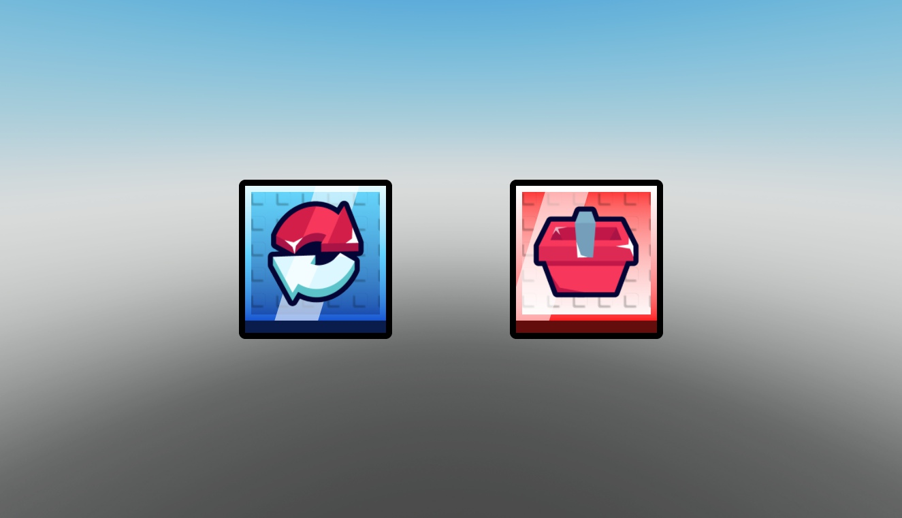

# Square Shine UI Buttons

Two square shop/index buttons with shine, animated inner strokes and falling/click icon effects.

**Preview release 0.1.0.** Native button assets and original effect scripts retained. Actual purchase/rebirth functionality and mobile/gamepad behavior are unverified.

## Download

[Download Square Shine Button [Free UI].rbxm](Square%20Shine%20Button%20%5BFree%20UI%5D.rbxm?raw=1) — 22,219 bytes.

[Full gallery — 1 screenshots](GALLERY.md) | [Native inventory](INVENTORY.md) | [Verification](VERIFICATION.md)

## Included assets

Two square shop/index buttons with shine, animated inner strokes and falling/click icon effects.

10 embedded scripts are extracted verbatim in [src/manifest.json](src/manifest.json). The binary is authoritative; do not install duplicate extracted copies.

## Installation

Move Shop Rebirth UI ScreenGui into StarterGui. Its Phone folder contains IndexButton and ShopButton. Position the buttons for your HUD and connect your own navigation callbacks. No rebirth, shop or purchase backend is included despite the original root name.

## Customization and dependencies

Work on a copy in Studio. Preserve required internal hierarchy, attachments, bones and relative transforms. Inspect [asset references](ASSET-REFERENCES.json); their availability in this Studio session does not guarantee permission in your destination experience. Keep original creator notices.

## Verification and limitations

Static Studio Edit inspection on isolated clones; no runtime behavior certification. Native instance counts/root names matched the supplied imports. Original scripts were disabled on static preview clones.

Native button assets and original effect scripts retained. Actual purchase/rebirth functionality and mobile/gamepad behavior are unverified.

SHA-256: `643f7386e007ab9345cd609b4ed228911c14dcc50f7fe6f22f8846a770bbdfed`

## Credits and license

[Credits](CREDITS.md) | [Scoped project MIT notice](LICENSE) | [Repository scope](../../../docs/LICENSING.md) | [Changelog](CHANGELOG.md)

[Back to category](../README.md)
