# Steal an Egg — Roblox HUD & Interface Pack

**Editable Roblox UI kit · 9 panels + fuse confirmation/result · 0.1.1 private draft**

[**Download StealAnEggUI.rbxm**](StealAnEggUI.rbxm?raw=1) · [Screenshot gallery](#screenshot-gallery) · [Asset credits](CREDITS.md)

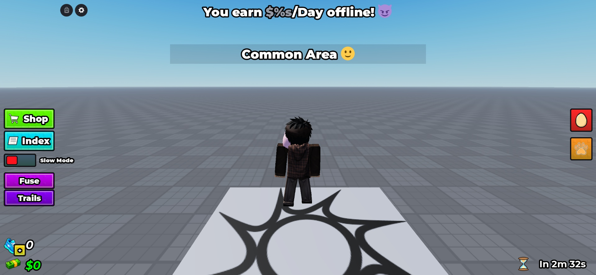

## Drag-and-drop setup

1. Download **[StealAnEggUI.rbxm](StealAnEggUI.rbxm?raw=1)**.
2. Stop Play in Roblox Studio and open Explorer.
3. Right-click **StarterGui → Insert from File…** and select the model.
4. If dragging the file into Studio puts it elsewhere, move **StealAnEggUI** onto **StarterGui**.
5. Press **Play**. All panels start closed; the controller is already included.

Import one copy. Back up customizations before replacing an existing copy.

```text
StarterGui
└── StealAnEggUI (ScreenGui)
    ├── Topbar (Backpack + Settings)
    ├── Controller (LocalScript)
    └── DesignCanvas
        ├── ResponsiveScale
        ├── HUD
        └── Panels
            ├── AllItems
            ├── Settings
            ├── Shop
            ├── SpeedShop
            ├── PetIndex
            ├── FuseMachine
            │   ├── Confirmation
            │   └── Result
            ├── TrailShop
            ├── ActivePets
            └── GrowingEggs
```

## Customize directly in Studio

- **Preview:** enable a panel's Visible property under DesignCanvas → Panels. Set it back to false before saving.
- **Edit:** named Frames, labels, gradients, borders, buttons and image instances remain editable. PNGs and actual upload IDs are in [assets/](assets/).
- **Preview scaling:** DesignCanvas → ResponsiveScale controls Edit-mode preview size. Play mode fits the 1333 × 682 design canvas to the camera viewport.
- **Routes:** Shop, Index, gear, speed plus, egg and paw buttons open their corresponding panels. Close the side drawer to access the HUD button behind it.
- **Fuse and Trails:** the labeled HUD buttons open these panels directly. Set the ScreenGui attribute ShowDemoLaunchers=false to hide these demo additions. Their original world launchers were not established by the references. From a LocalScript after ControllerReady, call `PlayerGui.StealAnEggUI.OpenPanel:Fire("FuseMachine")` or `"TrailShop"`. Calling the active panel again closes it.
- **Behavior:** edit the included Controller. All counters, rewards, purchases, pet fusion and growth actions are local demonstrations. Connect server-authoritative inventory, economy and persistence for a game.
- **Audio:** no reference audio is included. Music/SFX sliders expose local Value attributes but do not control a supplied soundtrack.

The top-bar backpack opens **All Items**, matching the video’s empty inventory view. It lists real local Roblox Tools, supports name search, and equips/unequips them; it does not invent pet ownership. The built-in Backpack display is disabled while this controller runs to prevent duplicate inventories. Settings and backpack follow the free space beside Roblox’s own controls.

## Screenshot gallery

Actual Studio MCP captures of the imported native model in Play mode. The baseplate, avatar and Roblox core controls are not included in the model. Screenshots are 1920 × 888 physical pixels; the measured runtime viewport is 1701.33 × 787.33 UI pixels. Scroll positions were selected for gallery views; mouse scrolling was tested separately.

| Shop — cash ### All Items

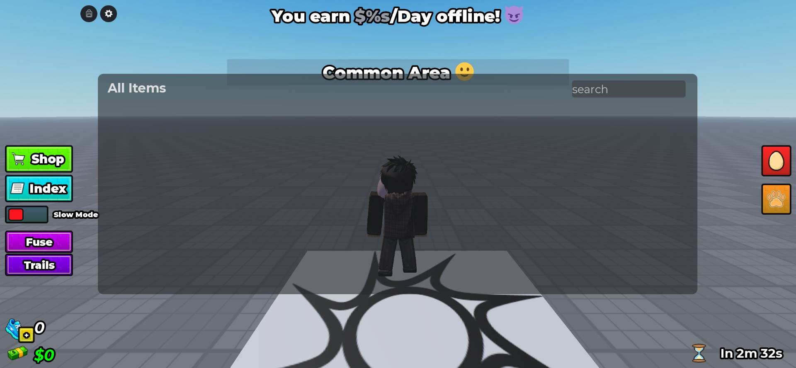

| Shop — limited offer |
| --- | --- |
| 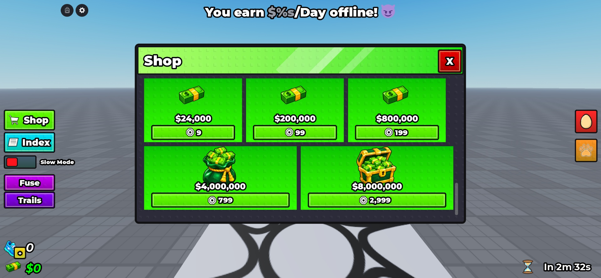 | 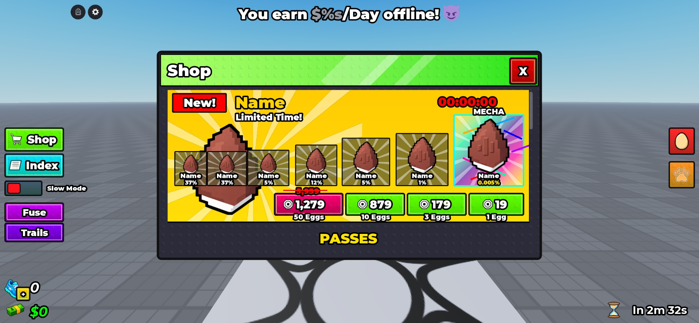 |

| Shop — passes | Shop — speed |
| --- | --- |
| 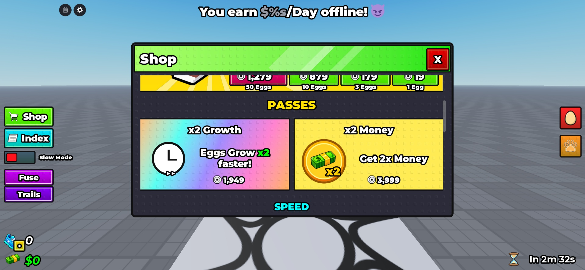 | 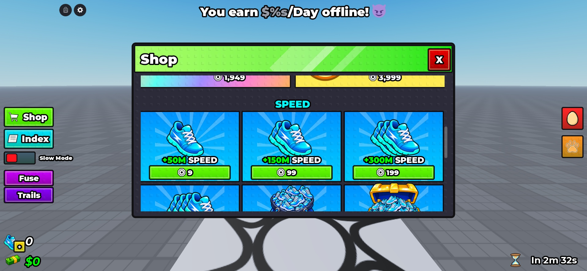 |

| Settings | Speed Shop |
| --- | --- |
| 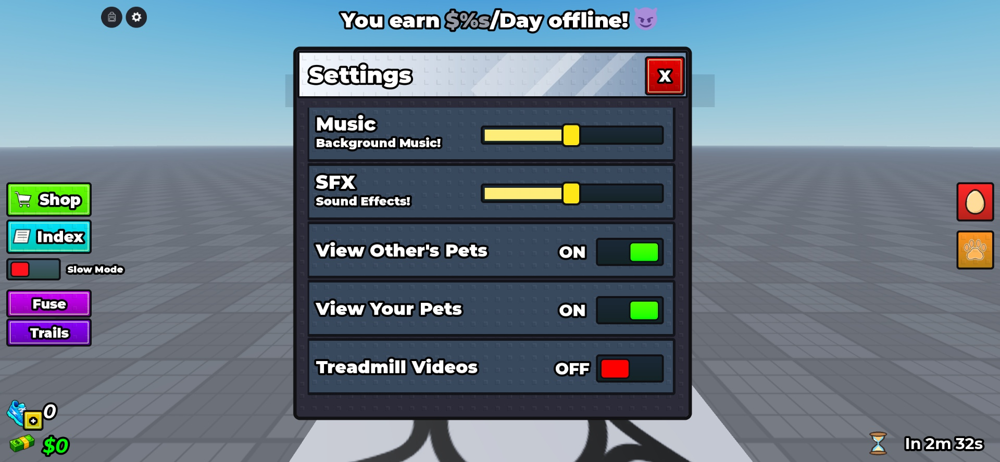 | 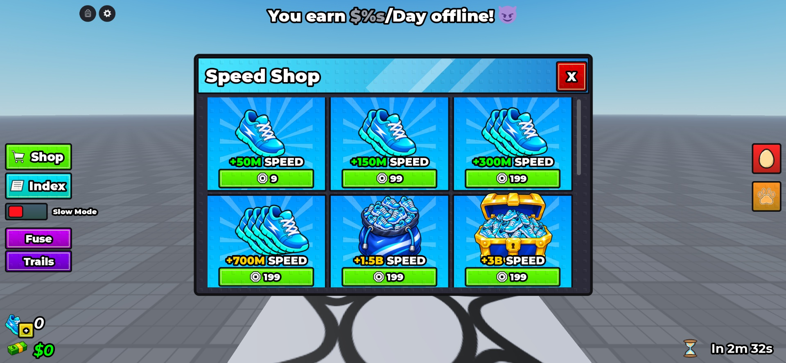 |

| Treadmill upgrade | Pet Index — Basic |
| --- | --- |
| 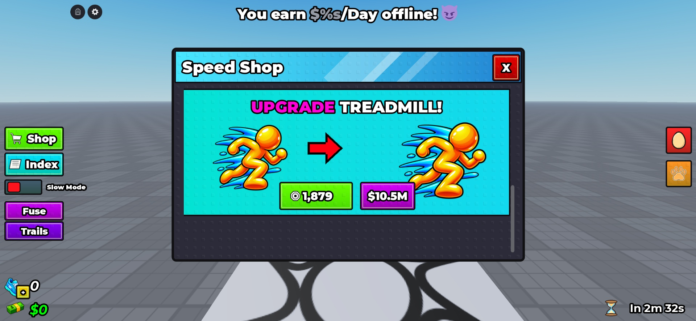 | 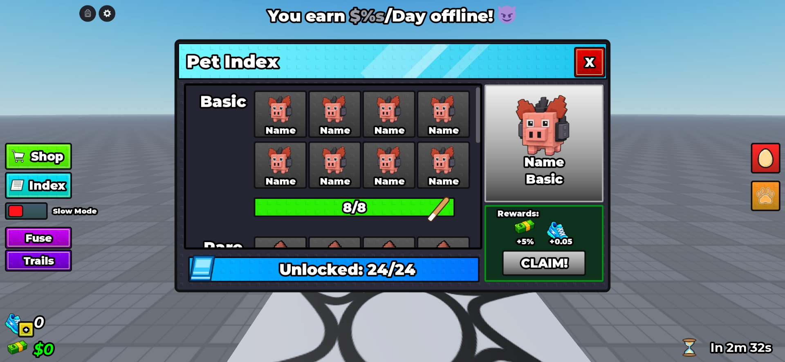 |

| Pet Index — Legendary | Pet Index — Rare |
| --- | --- |
| 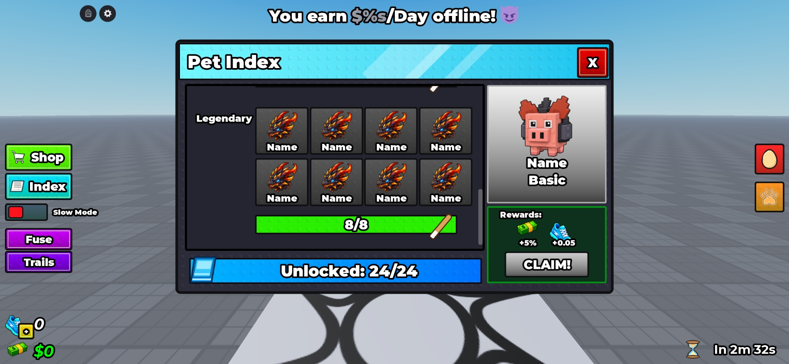 | 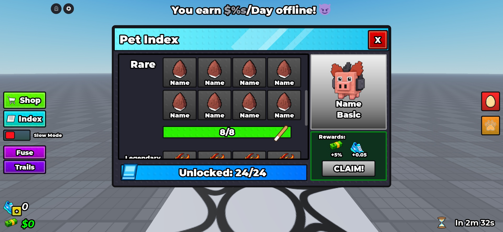 |

| Trail Shop — basic | Trail Shop — middle |
| --- | --- |
| 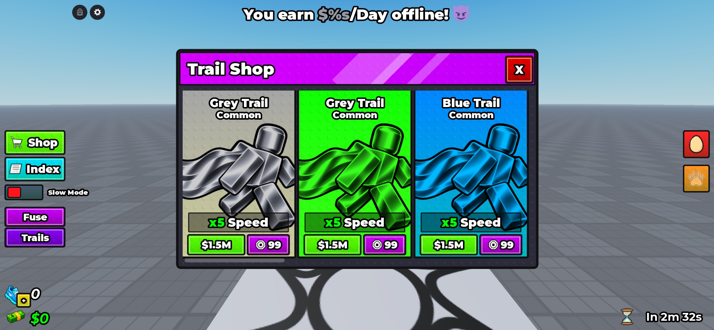 | 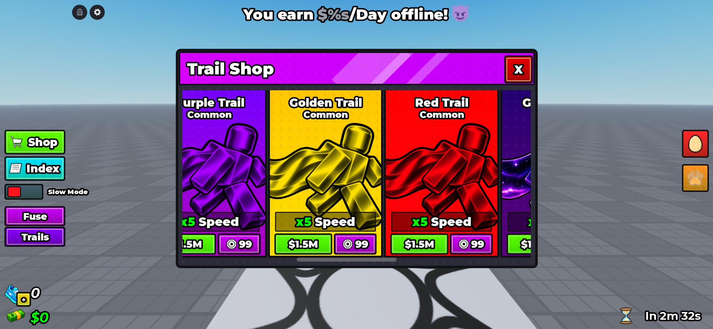 |

| Trail Shop — final | Active Pets |
| --- | --- |
| 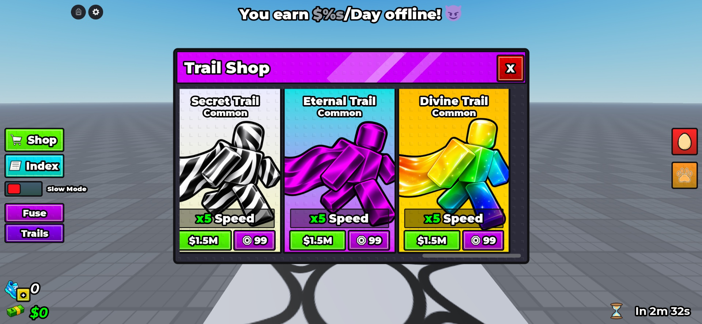 | 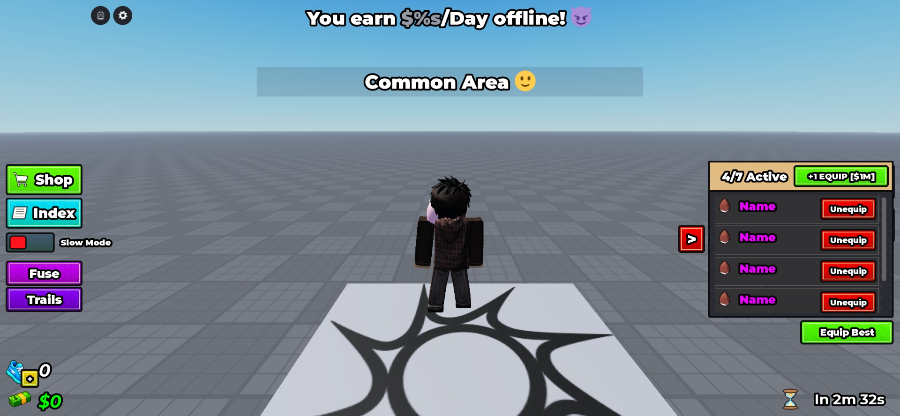 |

| Growing Eggs | Fuse Machine |
| --- | --- |
| 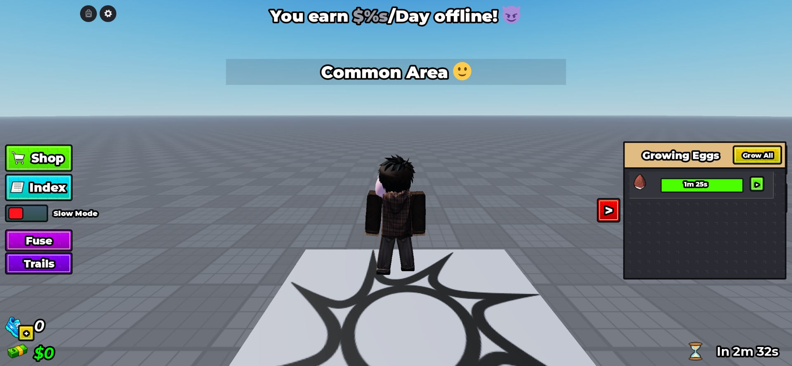 | 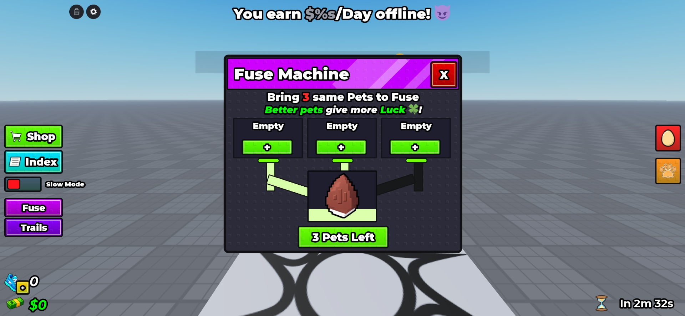 |

| Fuse — selected | Fuse — confirmation |
| --- | --- |
| 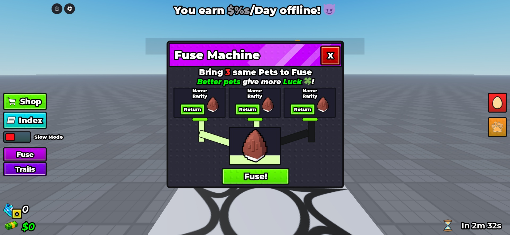 | 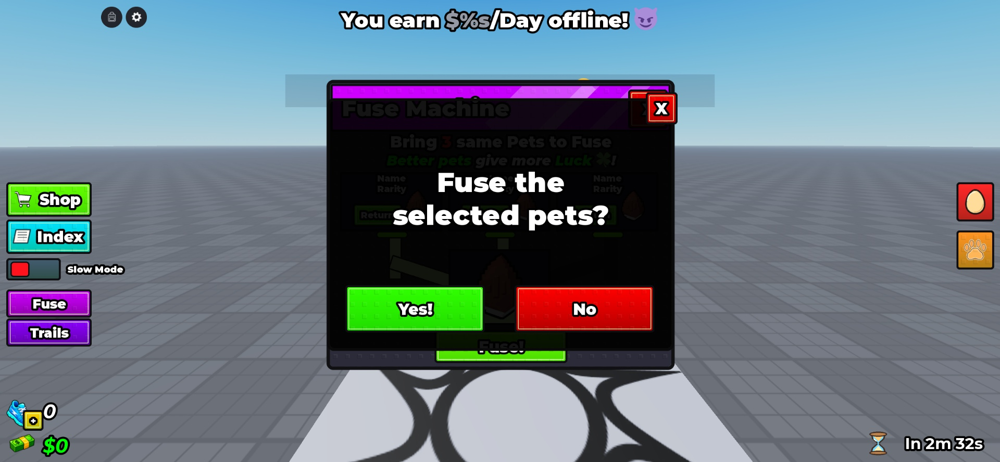 |

### Fuse — result

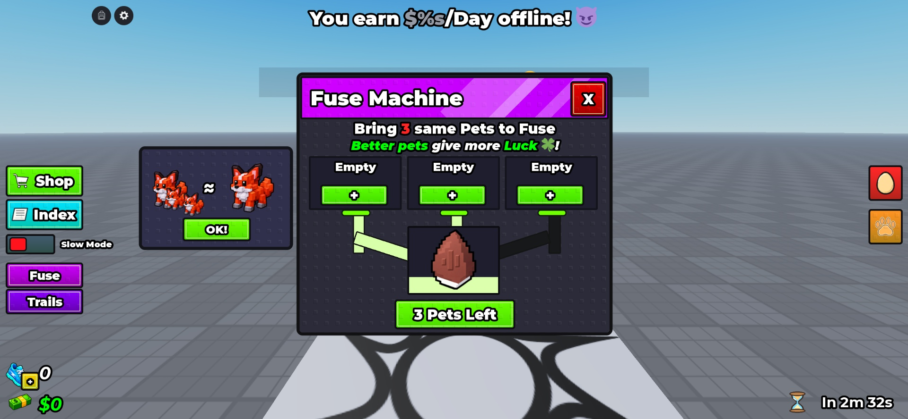

## What's in this folder?

```text
steal-an-egg/
├── README.md
├── StealAnEggUI.rbxm
├── previews/                 # HUD, every panel, scroll sections and fuse states
├── assets/                   # Original generated PNGs, geometry tools and IDs
├── src/
│   ├── Build.luau
│   └── Controller.luau
├── verification/             # Inventory, motion traces and checksums
├── pack.json
├── CREDITS.md
└── VERIFICATION.md
```

## Dependencies and verification

The native model has **1,838 descendants** and its controller survived Studio serialization/deserialization unchanged. Imported-model Play checks covered panel routes, rapid interruptions, sliders, toggles, vertical/horizontal scrolling, fuse confirmation/result, pet equip and egg-growth demos. Six visual review passes corrected geometry, fonts, artwork, pass colors, cash cards and missing glyphs.

**Desktop mouse only:** verified at 1701.33 × 787.33 UI pixels. The MCP schemas expose no device/viewport setters, so phone, tablet, reference-size, other desktop, console, resize and orientation tests remain blocked. Compact layout code is included but unverified. [Full coverage and limitations](VERIFICATION.md).

Generated artwork is a close recreation with visible art-style differences. Motion timing/easing is estimated from the supplied video; detailed timing equivalence for every transition and audio matching are not established. This is a private repository draft, not a production integration or a public release.

**Private draft / UNLICENSED:** reference/media redistribution rights have not been verified. No reuse or redistribution license is granted.

<details>
<summary>For pack maintainers: rebuild and export</summary>

Run `src/Build.luau` in Studio Edit mode to rebuild the editable StarterGui root. It replaces only the existing StealAnEggUI root and will replace customizations there. `src/Controller.luau` is a companion copy; editing it does not automatically update the embedded source in Build.luau.

Export through Studio SerializationService, deserialize the bytes and verify the imported model in Play. After changing source, regenerate the RBXM, hashes and affected screenshots. The shipped model needs no source-build tools or HTTP enabled.

The reference archive remains ignored under `.ui-reference/steal-an-egg/`; its manifest preserves the supplied video and seven carousel WebPs by hash.

</details>
