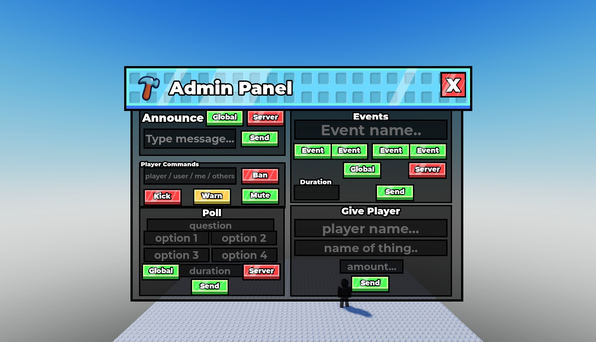
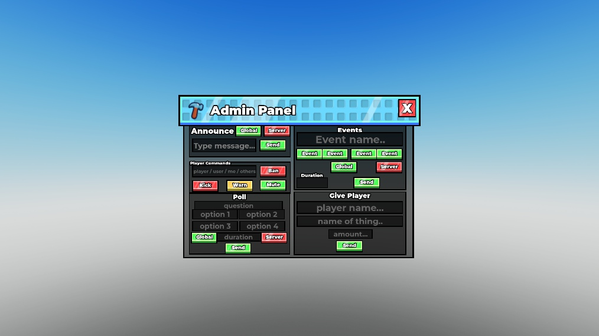
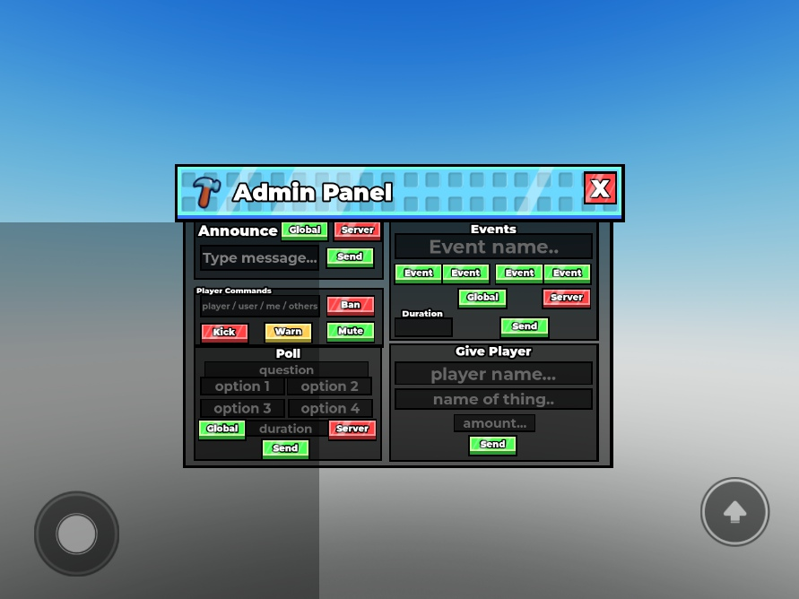
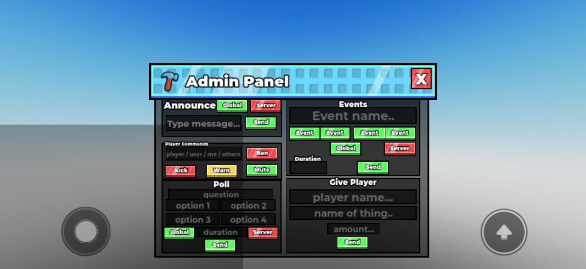
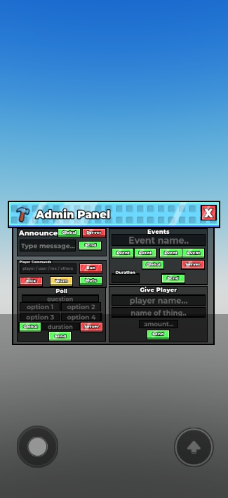
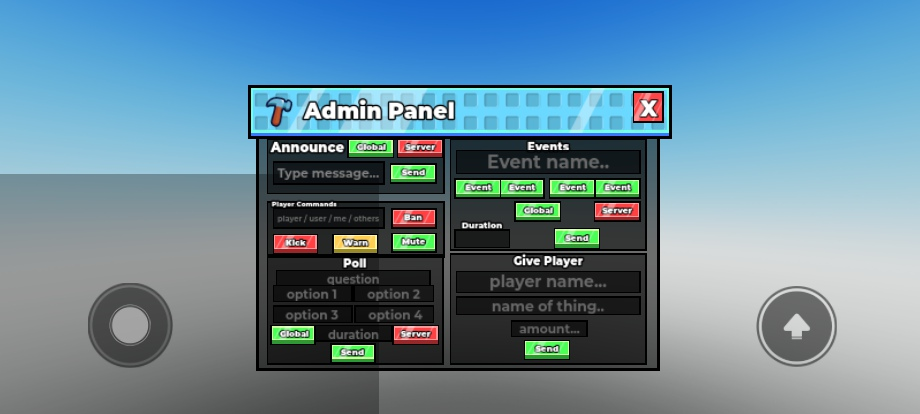
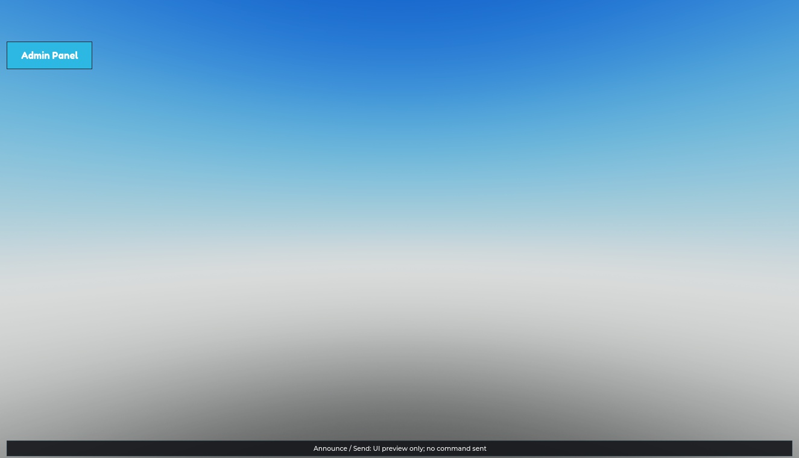

# Stud Admin Panel

**Keep the studs. Keep the layout. Lose the drifting buttons.**

A compact, editable admin **UI kit** preserving the supplied panel's original two-column composition, cyan header, hammer artwork, dark panels, and colored buttons. One proportional canvas keeps the artwork, borders, text, and controls together as the viewport changes. This is a **UI preview**, not a moderation backend.

**[Download the native model](StudAdminPanel.rbxm?raw=1)** · [Verification](VERIFICATION.md) · [Credits and licensing](CREDITS.md)

Status: **draft**. Imported native model and desktop interactions checked; desktop, tablet, and phone viewport fit checked in Studio. Small phone layouts remain compact rather than rearranging the design. See the limitations below.

## Included

| Panel | Contents |
| --- | --- |
| Announce | Message field, Global/Server scope, Send |
| Player Commands | Player field, Ban, Kick, Warn, Mute |
| Events | Event name, four event buttons, duration, scope, Send |
| Give Player | Player, item, amount, Send |
| Poll | Question, four options, duration, scope, Send |
| Shared controls | Original header and close button; reopening launcher; F4 toggle; brief UI-preview feedback |

## Screenshot gallery

These are actual Studio captures of the delivered native model, not mockups. The complete panel screenshots show all five included sections. Device screenshots use the simulator's **Fit to Window** display mode; their image pixel sizes can differ from simulated viewport sizes.

### Full desktop panel — every included section

### HD desktop

### Tablet

### Phone landscape

### Phone portrait

### Small phone landscape

### Closed panel / reopen launcher

## Install

1. Download `StudAdminPanel.rbxm` and stop Play in **Roblox Studio**.
2. In Explorer, right-click **StarterGui → Insert from File** and select the model. If it imports elsewhere, move the **Admin Panel** ScreenGui into StarterGui.
3. Keep only one copy. The root contains `Canvas`, `Open`, `Layout` (ModuleScript), and `Controller` (LocalScript).
4. Test in a place with a floor and a SpawnLocation so the test character does not repeatedly fall into the void.
5. Press Play. Close with **X**, reopen with **Admin Panel**, or toggle with **F4** when no text field is consuming input.
6. Type into a field and click an action. Actions show **UI preview only** feedback; they do not send commands.

No packages, plugins, remote code, API keys, or external modules are required. Linked Roblox images must be accessible in the destination experience; IDs are in [CREDITS.md](CREDITS.md).

## Customize

- **Authored UI source:** the editable instance hierarchy in `StudAdminPanel.rbxm` is authoritative. Expand `Canvas` to edit the existing labels, fields, images, borders, and buttons directly in Studio. It is not a flattened screenshot.
- **Responsive code:** [src/Layout.luau](src/Layout.luau) matches the embedded `Layout` ModuleScript. The design canvas is 780 × 540, with 12-pixel viewport margins and a maximum scale of 1. Change those constants together if changing the design dimensions.
- **Preview behavior:** [src/Controller.client.luau](src/Controller.client.luau) matches the embedded `Controller` LocalScript. Update the embedded script when editing its companion source, then re-export the native model.
- Panels retain their original names under `Canvas.Frame`. Some original controls intentionally share names; inspect their class and parent when wiring game-specific actions.
- `ResetOnSpawn=false` preserves panel state and field contents across respawn. `DisplayOrder=50` keeps the kit above normal gameplay touch controls.

## Compatibility and limits

- Preserves the original composition at every tested size; it does **not** stretch buttons or reflow the sections into a different dashboard.
- Uses `CoreUISafeInsets`, safe-area clipping, and uniform scaling. The entire canvas was within the reported safe GUI bounds in every recorded test.
- **Phone portrait is a compact overview.** Keeping the entire original two-column layout means text and touch targets become small; this is not a 44-pixel-minimum touch-target interface. Landscape is preferable for phones. Physical-device keyboard occlusion, touch gestures, gamepad, console, and VR have not been verified.
- Core chat or another higher-order overlay can intercept input; collapse it while testing. Use **Fit to Window** in Studio's device simulator to avoid confusing an oversized simulator surface with UI clipping.
- Server authorization, target resolution, text filtering, rate limits, moderation persistence, cross-server messaging, polling, and item/currency grants are **not implemented**. Validate and authorize all real admin actions on the server; hiding this GUI is not a permission system.

## Development checks

Run `python packs/ui/stud-admin-panel/tools/check_pack.py` from the repository root to validate the documented files, model signature, preview images, and recorded viewport bounds. This is a packaging check, not a substitute for Studio Play testing.

Original contributions use [MIT terms](LICENSE); the supplied design and externally hosted art retain their existing rights. See [CREDITS.md](CREDITS.md).
