# Studs UI Pack 2

An editable simulator UI with a HUD and nine panels. Includes three readable Luau scripts for panel animation, button hover/click scale effects, tagged rotating sunbursts, and UI sounds. Purchases, currency, XP, rewards, settings toggles, item filters, and upgrades display example content and require game integration.

[Download StudsUIPack2.rbxm](StudsUIPack2.rbxm) · [Item inventory](inventory.json) · [Script review](SECURITY.md) · [Credits](CREDITS.md) · [License](LICENSE)

## Installation

1. Insert the downloaded model into Workspace in Roblox Studio. It contains three folders named by destination.
2. Move `StarterGui/GameUI` into the real StarterGui service.
3. Move the contents of the imported `StarterPlayerScripts` folder into `StarterPlayer > StarterPlayerScripts`. Keep ClientSoundsManager and OpenManager beneath LocalScript.
4. Move `SoundService/SFX` into the real SoundService. Remove the empty imported folders.
5. Press Play. The Starter Pack offer appears first; close it, then use the HUD to open panels. Avoid installing a second GUI named GameUI.

## Included content

| View | Contents |
| --- | --- |
| HUD | Daily, Shop, Pass, Rebirth, Index, currency, rebirth count, level/XP bar, multipliers, level product buttons, Starter Pack, X2 Money, X2 Luck, Base, Stock Shop, Upgrades. |
| Index | 24 item placeholders, rarity labels from Common through Secret, and completion display. |
| Pass | Free and premium reward tracks, levels, XP, claim and skip layouts; horizontal scrolling. |
| Rebirth | Current/next multiplier, requirements, rebirth and paid-skip layouts. |
| Shop | Exclusive crate display, starter offer, server luck, X2 Money and X2 Luck cards; vertical scrolling. |
| StockShop | Common and Rare crate cards, stock counts, cash/Robux price layouts and restock button. |
| Upgrades | Opening Speed, Index Rewards Mult, and Inventory Size upgrade cards. |
| Daily | Seven-day reward layout with claimed, claimable and locked examples. |
| Settings | Music, SFX and VFX rows. Previewed directly; no HUD entry point is supplied. |
| StarterPack | Crate, money boost, luck boost, tool placeholder and example price. |

## Behavior and customization

Eight HUD panel links and Close buttons use OpenManager. Hover and press effects animate UIScale; tagged `SunRotate` GUI objects rotate. ClientSoundsManager plays named SoundService/SFX sounds. Settings has no HUD link; add your own entry point using the same OpenManager pattern. Source files under `src/` match the exported scripts; the native model is authoritative for visual instances.

Edit GameUI’s native frames, labels, images, gradients, colors and sample prices in Studio. Replace placeholder names and crate odds before integrating a real economy; displayed sample crate percentages are not a normalized probability table. Purchases, claims, pass progression, rebirths, inventory, upgrades, settings persistence, My Base, and level-product actions have no authoritative game implementation in this kit.

## Gallery

Actual Studio captures at 1920 × 888.

### Ui Hud

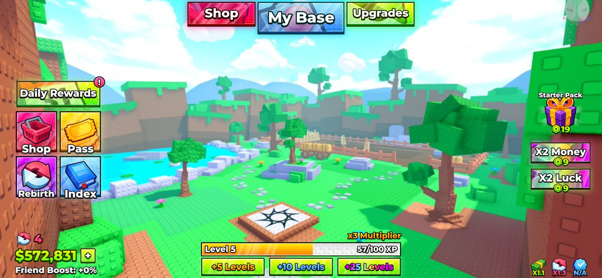

### Ui Starterpack

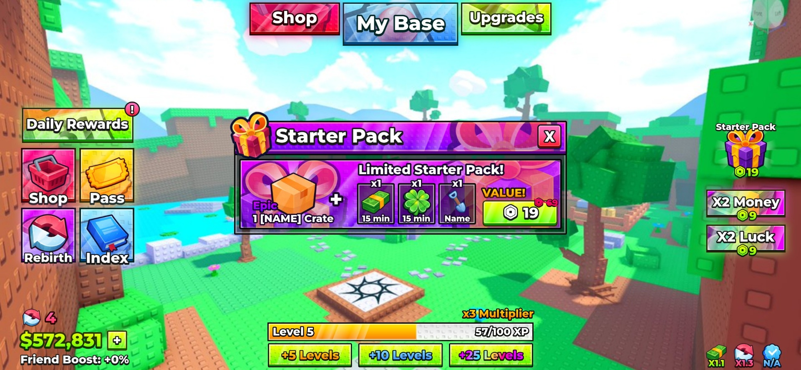

### Ui Index

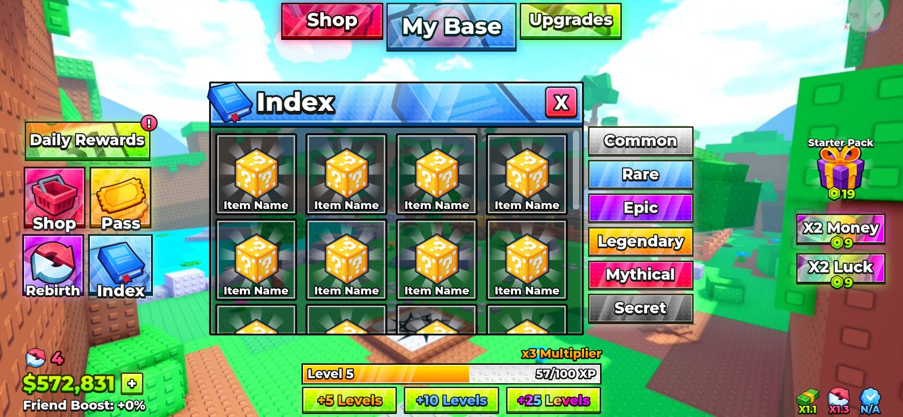

### Ui Pass

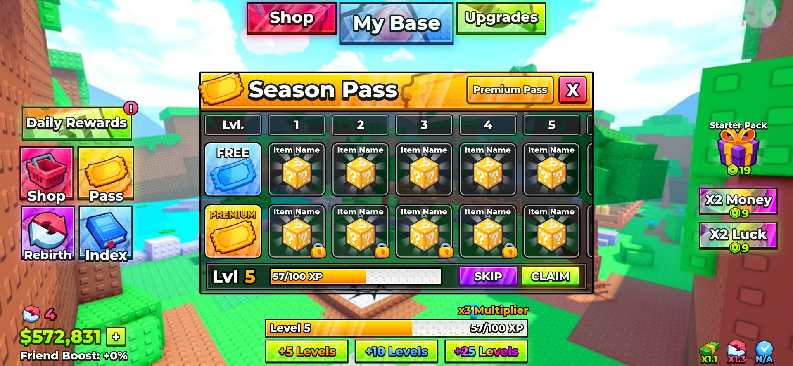

### Ui Rebirth

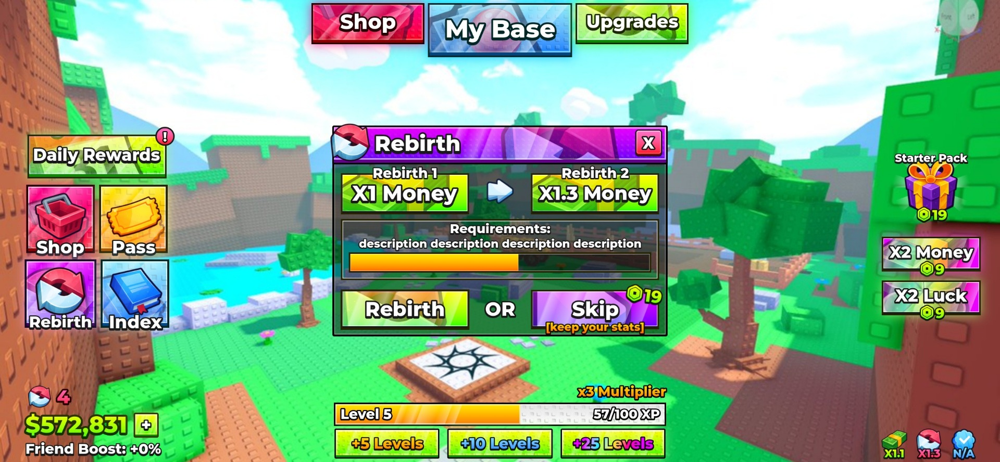

### Ui Shop

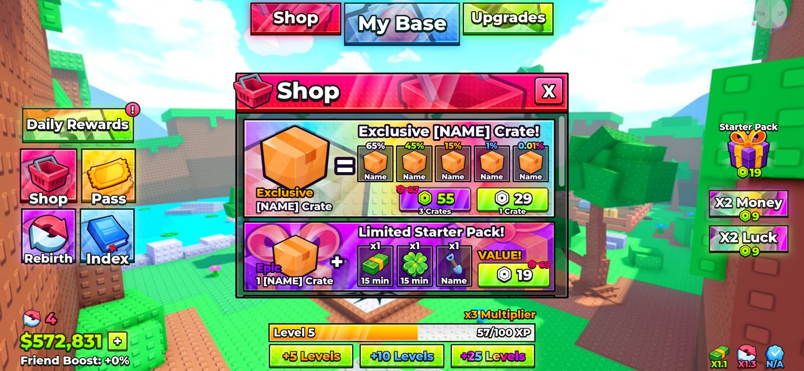

### Ui Stockshop

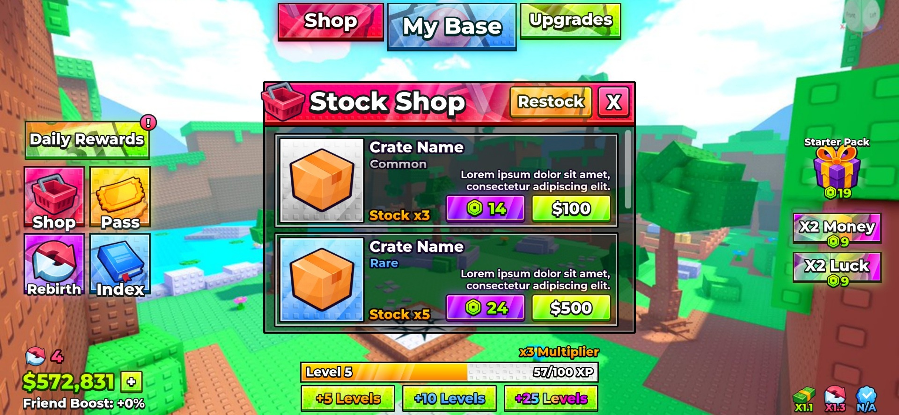

### Ui Upgrades

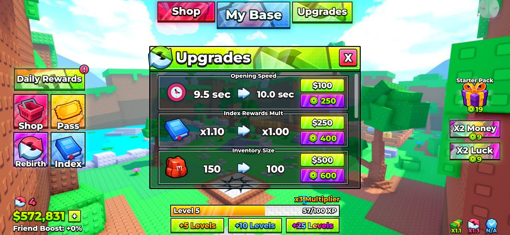

### Ui Daily

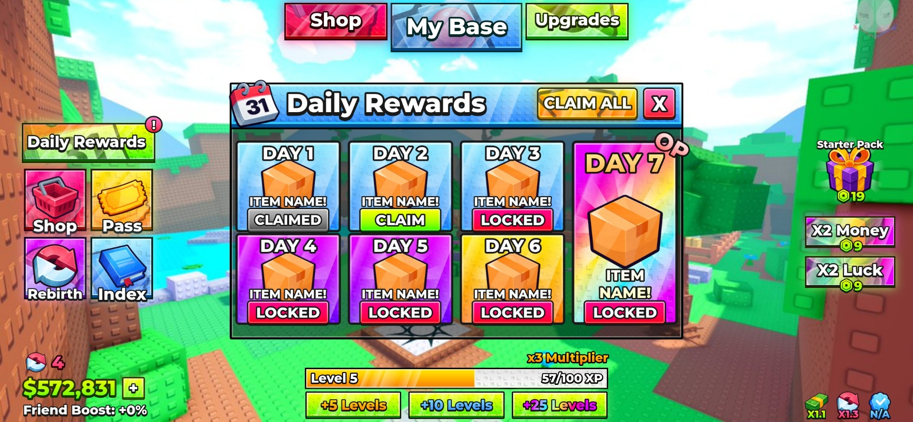

### Ui Extra Settings

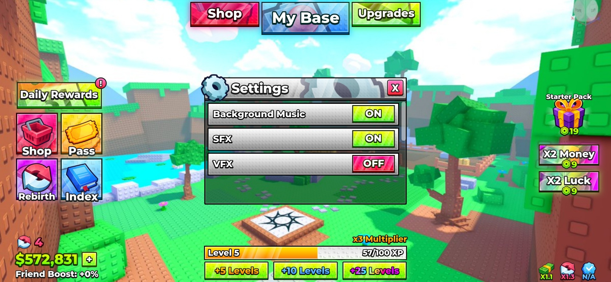

### Ui Extra Shop

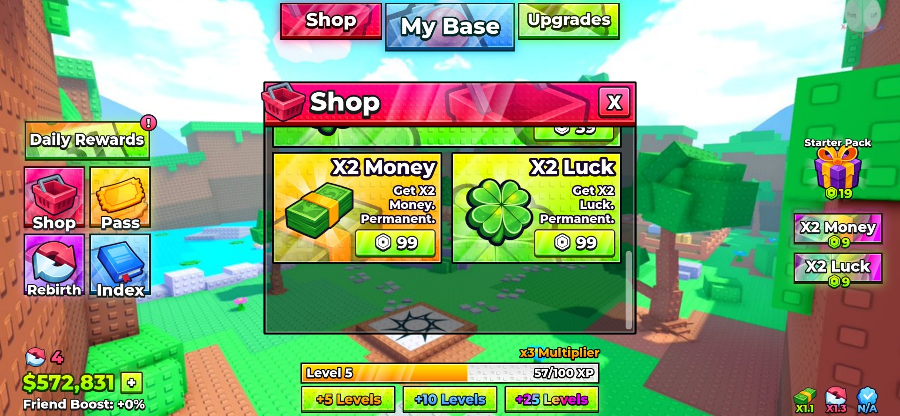

## Verification

See [VERIFICATION.md](VERIFICATION.md) for the tested import and preview scope, and [SECURITY.md](SECURITY.md) for the script review.
