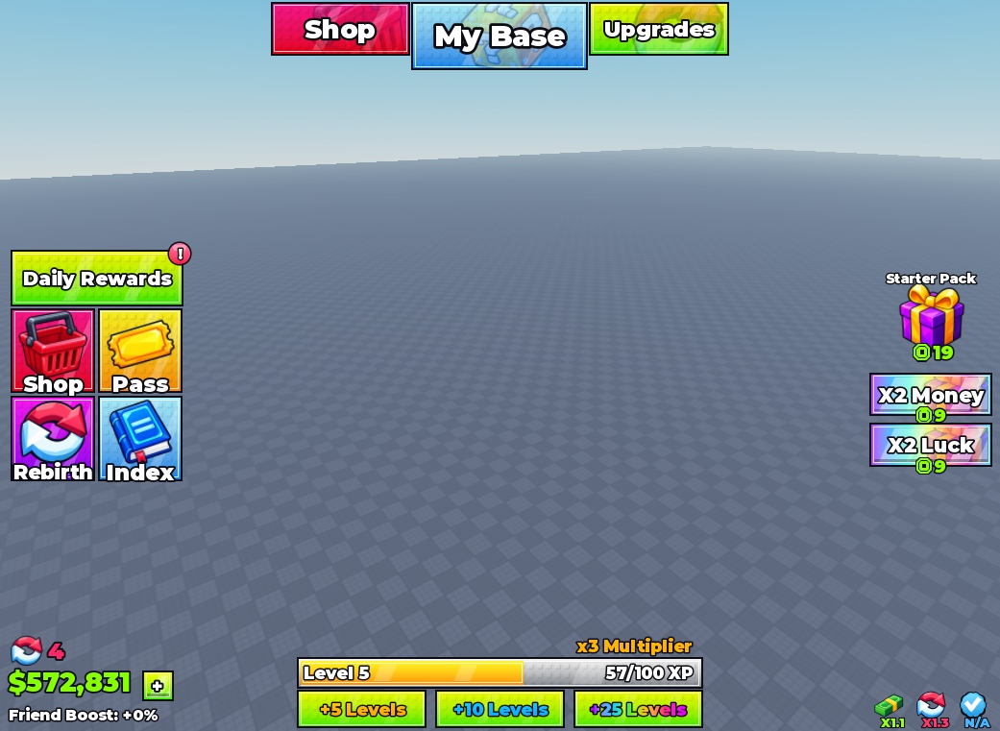
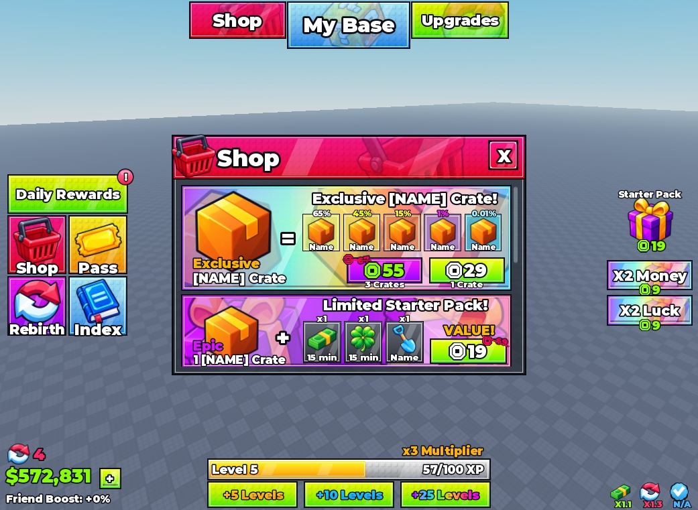
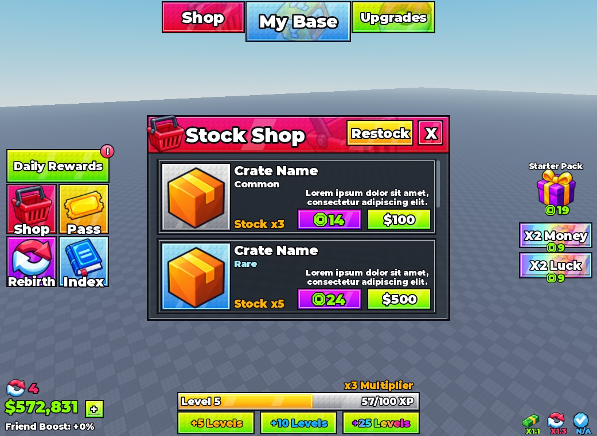
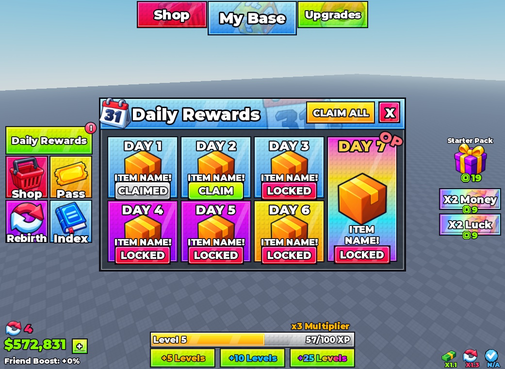
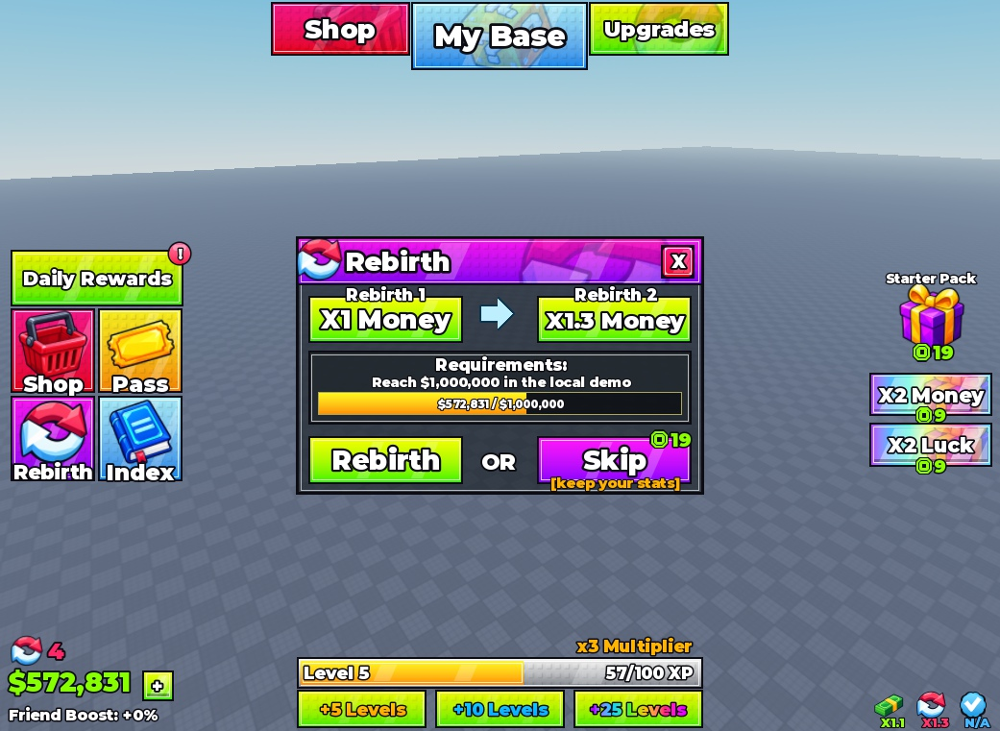
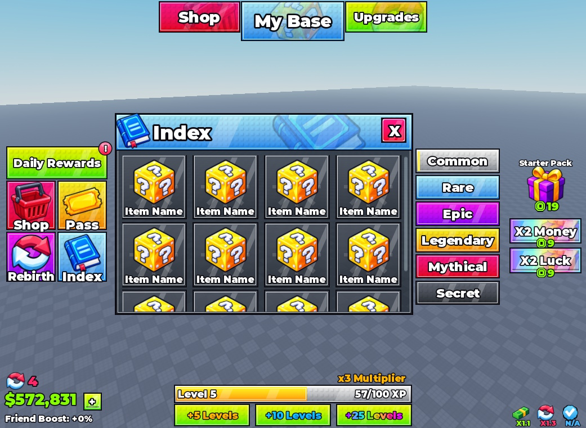
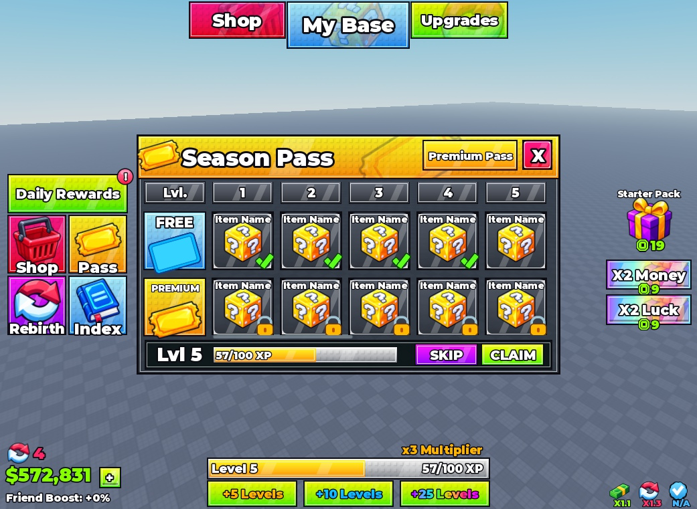
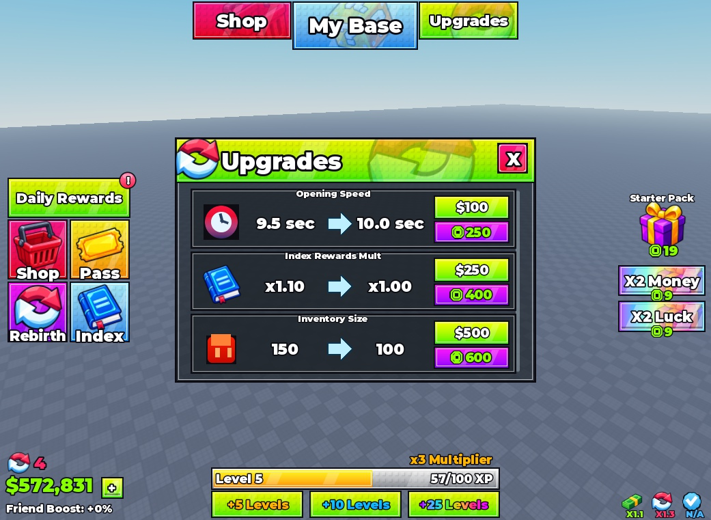
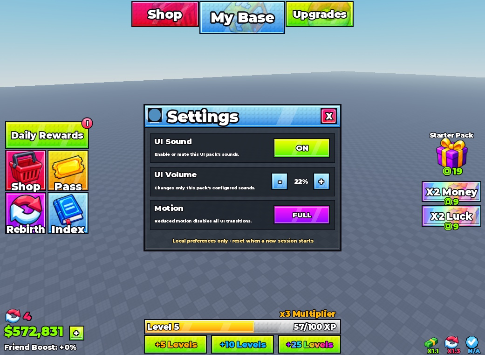
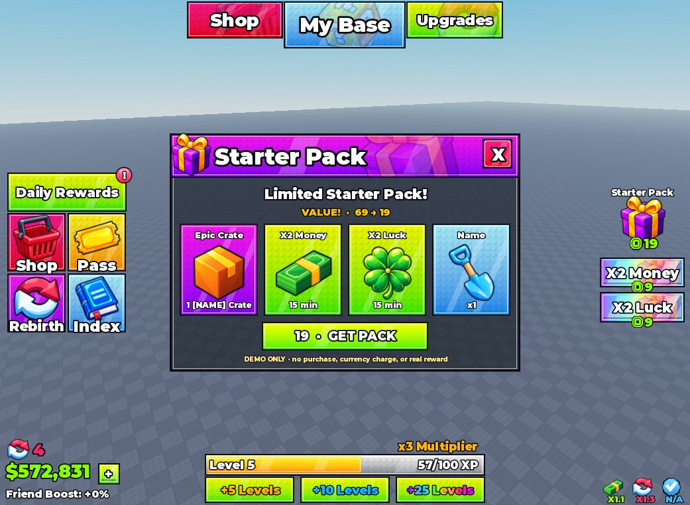

# Steal a Template / Studs UI — Roblox HUD & Interface Pack

**Editable Roblox UI kit · 9 panels · 4-sided HUD · 0.1.0**

[**Download StudsUI.rbxm**](StudsUI.rbxm?raw=1) · [Screenshot gallery](#screenshot-gallery) · [Asset credits](CREDITS.md)



## Drag-and-drop setup

1. Download **[StudsUI.rbxm](StudsUI.rbxm?raw=1)**. You do **not** need the whole repository.
2. In Roblox Studio, stop Play and open **Explorer**.
3. Right-click **StarterGui → Insert from File…**, then select the downloaded file. This places the pack directly in StarterGui.
4. Alternatively, drag the model file into Studio, then drag the imported **StudsUI** ScreenGui onto **StarterGui** in Explorer if it landed elsewhere.
5. Press **Play** to try the buttons and transitions. All panels start closed.

**No Command Bar paste, Rojo, plugin, external code loader or extra script placement is needed.** Import only one copy; back up existing customizations before replacing it. Dropping onto the 3D viewport is not an automatic StarterGui installer.

The intended hierarchy is:

```text
StarterGui
└── StudsUI (ScreenGui)
    ├── Controller (LocalScript — already included)
    └── DesignCanvas
        ├── HUD
        └── Modals
            ├── DailyRewards
            ├── Shop
            ├── StockShop
            ├── Rebirth
            ├── Index
            ├── SeasonPass
            ├── Upgrades
            ├── Settings
            └── StarterPack
```

Roblox's [UI setup documentation](https://create.roblox.com/docs/tutorials/curriculums/user-interface-design/implement-designs-in-studio) explains why player-facing ScreenGuis belong under StarterGui.

## Customize directly in Studio

Everything is editable: frames, text, gradients, borders, icons, buttons and the controller.

- **Preview a panel without playing:** expand `DesignCanvas → Modals`, select a panel and enable **Visible**. Hide the others while editing. Set it back to false when finished.
- **Change text/colors/art:** select the named instance and edit its Properties. Image sources and uploaded IDs are included in [assets/](assets/).
- **Adjust the Edit-mode preview:** change `DesignCanvas → ResponsiveScale.Scale` if your viewport differs. The included preview fit was captured at 1041×761; the controller adapts to the actual viewport during Play.
- **Change sounds:** edit the ScreenGui's `OpenSoundId`, `CloseSoundId`, `HoverSoundId`, `ClickSoundId` and `SoundVolume` attributes. Empty IDs disable sounds.
- **Change behavior:** edit the included `Controller`. The left Shop button opens Stock Shop; the top Shop button opens the premium offers panel.
- **Settings placement:** its panel is included, but its launcher is intentionally hidden because the references did not establish a location. Place your own launcher if your game needs one.
- Save your place to retain edits. You do not need to rebuild source files just to customize an imported copy.

**Important:** purchase, reward, currency and progression behavior is a local demo. It does not charge Robux, grant real rewards or save player data. Connect your own server-authoritative systems before production use.

## Screenshot gallery

Actual Studio captures of the imported model—not the original reference screenshots. The gray baseplate is a preview environment and is not included in the model. Panels were shown individually in Edit mode.

| Premium Shop | Stock Shop |
| --- | --- |
|  |  |

| Daily Rewards | Rebirth |
| --- | --- |
|  |  |

| Index | Season Pass |
| --- | --- |
|  |  |

| Upgrades | Settings |
| --- | --- |
|  |  |

### Starter Pack



## What's in this folder?

```text
studs-ui/
├── README.md                 # Setup and screenshot gallery
├── StudsUI.rbxm               # Main download: native editable model
├── previews/                 # HUD + all nine panels
├── assets/                   # PNG sources, Roblox IDs and generation notes
├── src/                      # Authoring installer + controller source
├── exports/
│   ├── studs-ui.rbxmx         # Alternative XML authoring export
│   └── native-export.json    # Native-model/source checksums
├── tests/
├── tools/
├── pack.json
├── CREDITS.md
└── VERIFICATION.md
```

## Dependencies and verification

Image/audio files are delivered by Roblox; verify access in your destination experience. Local PNGs are retained for re-upload if needed. No third-party code package is required.

The native model was serialized and deserialized in Studio, placed under StarterGui and visually inspected in Edit mode. Its 3,454 instances and embedded controller survived the round trip. Fresh-place Play, mobile/gamepad and broad viewport testing remain pending; see [VERIFICATION.md](VERIFICATION.md).

Original Steal a Template code and assets use the [MIT License](LICENSE). See [credits and permissions](CREDITS.md) for reference designs and third-party material.

<details>
<summary>For pack maintainers: source builds and checks</summary>

`src/Build.luau` remains the authoritative authoring scene. Running it in Edit mode replaces this pack's existing StudsUI root; it does not merge customizations. `src/Controller.luau` is a companion copy and is not automatically embedded when edited.

From the repository root:

```powershell
python -B packs/ui/studs-ui/tools/build_export.py --check
python -B -m unittest discover -s packs/ui/studs-ui/tests
python -B packs/ui/studs-ui/tools/validate_pack.py packs/ui/studs-ui
```

The Python exporter rebuilds the XML file only. After visual/source changes, regenerate the native RBXM through Studio, refresh its checksums and recapture previews; do not distribute a stale native file.

</details>
