# Surface Inventory - Roblox SurfaceGui Interface Pack


**Editable native UI ? 1 inventory panel ? 60 slots ? 0.5.2 tested draft**


[**Download SurfaceInventory.rbxm**](SurfaceInventory.rbxm?raw=1) ? [Screenshot gallery](#screenshot-gallery) ? [Asset credits](CREDITS.md)


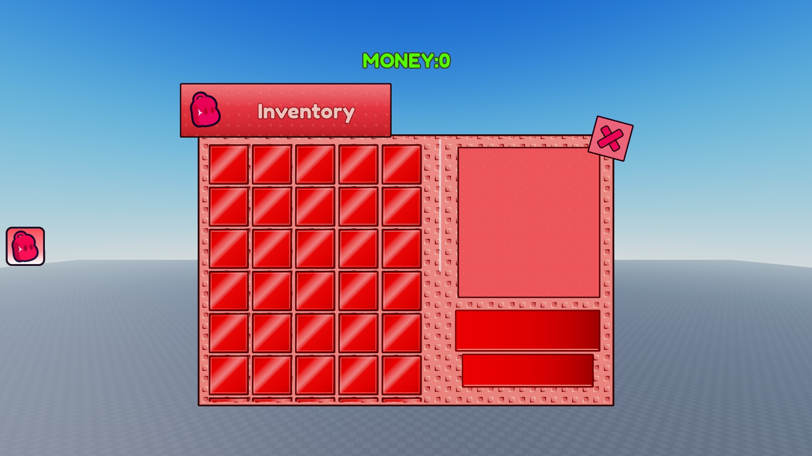


## Drag-and-drop setup


1. Stop Play in Roblox Studio.

2. Right-click **StarterGui ? Insert from File** and choose **SurfaceInventory.rbxm**. Alternatively import it and move its ScreenGui into StarterGui.

3. Press Play. The inventory starts closed. Click the left backpack button or press **I**. The X closes it; repeated I input reverses the transition.

4. Import one copy. All visible UI, configuration and controller source are already inside the model; no external code loader, source paste or extra plugin is required by the runtime design.


**Import-test caveat:** the actual Studio-native binary was serialized, decoded, inspected and its UI reinserted. Raw MCP parenting of serialized scripts was rejected by a Network-capability gate; their byte-identical embedded sources were restored with the supported Studio script editor before Play verification. This is not a certified fresh-place, one-step Insert from File test.


```text

StarterGui

??? SurfaceInventory (ScreenGui; ResetOnSpawn=false)

    ??? Controller (included LocalScript)

    ??? Config (ModuleScript)

    ??? Launcher / Money (native HUD)

    ??? InventorySurface (SurfaceGui; ResetOnSpawn=false)

    ?   ??? Canvas / Panel

    ?       ??? Studs / Title / Close

    ?       ??? Slots (ScrollingFrame; 60 editable buttons)

    ?       ??? Detail (blank, with subtle animated studs)

    ?       ??? ActionPrimary / ActionSecondary (blank)

    ??? OpenRequested / ItemSelected / ActionRequested (local BindableEvents)

```


At runtime the included controller starts one copy of itself in PlayerScripts so deferred destruction signals can clean up safely. The SurfaceGui moves under PlayerGui for surface input; an invisible, queryable proxy Part follows the camera from Workspace. Destroying the root removes that surface, proxy and driver. The script never reconstructs the visible interface.


## Customize directly in Studio


- Text, gradients, outlines, slots, embossed studs and cross geometry are editable instances. The backpack is an individual transparent image, **not an image of the whole interface**.

- Edit `Config` for tilt, distance, opening frequency/damping, stagger, `HoverResponse`, `BackpackArrivalSeconds`, `StudSpeed`, key and optional static MONEY:0 demo HUD. Desktop tilt is bounded at 6 degrees; compact layouts reduce it.

- The uploaded backpack is **rbxassetid://86135425235678**; its source PNG, prompt and provenance are in assets/. Both image loads were observed in Studio. Access under other owners/experiences remains untested.

- A nonempty `BackpackImage` overrides the authored image. Empty currently preserves the authored visibility state. To use the retained native approximation, set the override empty, hide each `UploadedBackpack`, and show its sibling `NativeBackpack` in Studio; do not rely on the older shorthand comment alone.

- For Edit-mode 3D preview, copy the SurfaceGui under a temporary anchored Workspace Part and set its Adornee to that Part. The original template should keep Adornee unset. Delete only your temporary preview afterward.

- Compact portrait uses four columns and a scrollable grid; compact landscape uses five scrollable columns. The launcher and optional money label hide while compact inventory is open. Touch-control space and console HUD margins are reserved. Desktop composition remains a five-column grid, now overflowing into additional rows with a native white scroll thumb.

- `OpenRequested:Fire(true/false)` requests visibility. `ItemSelected.Event` emits the selected slot. `ActionRequested.Event` emits primary/secondary plus that slot. These are **local demo hooks**, not authoritative inventory, equip, purchases or rewards.

- The references show blank cells, detail and action bars. No invented item names or action labels were added. Selection is an explicitly inferred demo interaction. No unrelated video soundtrack is included.


## Skinny scrollbar and requested render checks (0.5.1)


The native thumb is now4px instead of10px on desktop (60% thinner), with the same center position in the gutter. Compact thumb is4px too. Native drag/wheel and cell60 selection were replayed after reimport.


Both videos were rechecked, but their compressed frames do not expose a reliably measurable white thumb. No exact source-width claim is made. Headless rendering and Pixelmatch were run at a controlled1:1 native canvas: the installed renderer omits native scrollbar paint, producing940/6600 mismatched crop pixels. That diagnoses a renderer limitation, **not reference accuracy or a passing fidelity score**. See [verification and diff](VERIFICATION.md).


## Real scrolling and white thumb (0.5.0)


The grid now contains60 native blank cells. Desktop also scrolls: its497x550 viewport covers1078px of content. The genuine white4px scrollbar thumb sits between the five-column grid and right detail pane, centered in the former empty gutter. It supports mouse dragging and wheel scrolling; it is not a decorative fake bar. Compact layouts retain scrolling with a4px white thumb. Content height is derived from the actual number of authored slot buttons.


The count increase and prominent white scrollbar are the user-requested extension, not a claim that the videos originally contained60 cells. Prior bevel, background motion and title clearance fixes remain.


## Bevel and visible motion refinement (0.4.0)


Studs now have flatter red centers with rounded raised/socket bevels, strong dark lower-left and bright upper-right edges, reversed for recessed squares. The supplied gray image guided relief/shadow treatment, not palette. All relief pieces remain editable native frames/corners/gradients.


Background movement now uses fractional translation and real elapsed time at18 canvas pixels/sec down-left, rather than barely visible7px/sec integer-offset stepping. Main panel, faint title and smaller detail patterns share the seamless44px/two-cell period. Actual Studio frames show the pattern changing while controls remain fixed.


## Title clearance fix (0.3.1)


The title/backpack plaque now sits clear of the top row: 20 native-canvas pixels at rest on desktop, with room for the first cell's rotated hover corners and outlines. Portrait/compact headers also have extra clearance. Opening overshoot is slightly bounded and recentered to avoid pushing the raised plaque offscreen.


## Motion and grid refinements (0.3.0)


- The grid has 16px native-canvas breathing room for full outlines and rotated hover corners; cells keep their center pivots and do not reflow neighbors.

- Backpack hover smoothly turns clockwise and enlarges; cells do the same independently. A subtle slow startup turn is reconstructed, not a certified original idle loop.

- The upper bar is both wider and taller; both bars grow from their centers on hover and return smoothly. Compact bar heights preserve usable targets.

- Opposite raised/recessed stud bevels alternate. Main panel, faint title texture and subtler detail texture scroll diagonally down-left with a seamless two-cell wrap. The18px/sec speed is configurable; exact source speed is unmeasured.


## Screenshot gallery


These are **actual Studio Client captures** of the native UI after deserialization and the identical-source script-editor restoration described above. They are not reference frames, AI mockups or headless substitutes. Emulator captures may include platform touch controls/overlays and simulator scaling. See VERIFICATION.md for exact logical viewports, motion traces, and import/input limits. All16 captures were refreshed for the0.5.1 skinny-scrollbar revision on the reimported native UI. Desktop last-row selection and compact scrolling are included; prior bevel-motion samples retain their original version.


| Closed HUD | Open inventory |

| --- | --- |

| 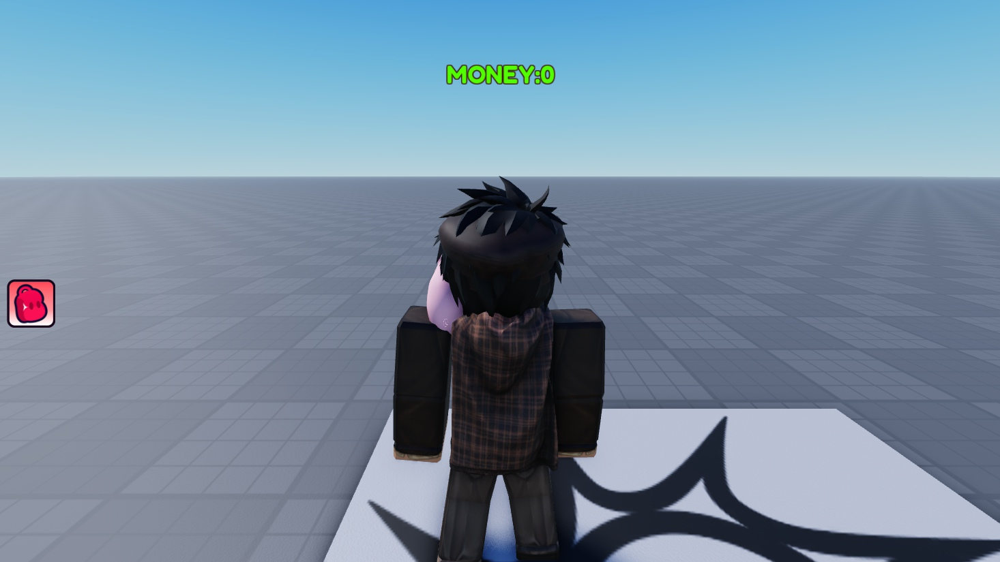 |  |


| Opening overshoot | Row-major reveal |

| --- | --- |

| 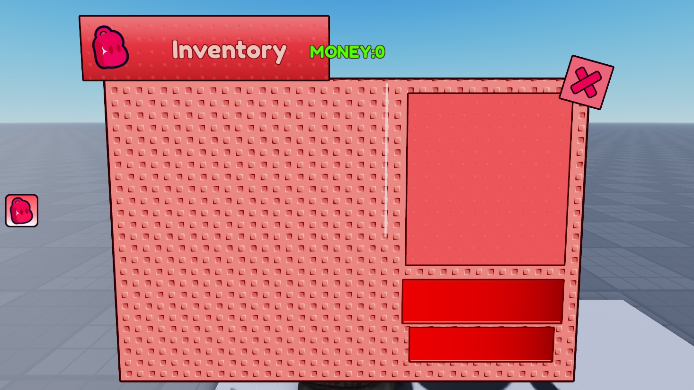 | 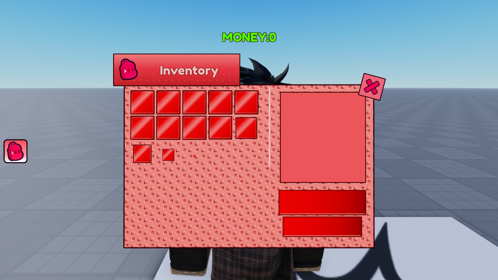 |


| Selected-slot demo | Compact grid scrolled to bottom |

| --- | --- |

| 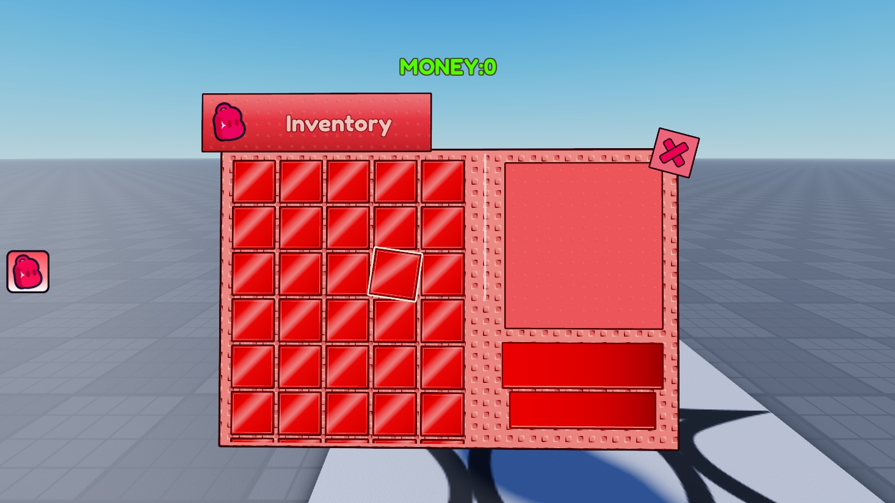 | 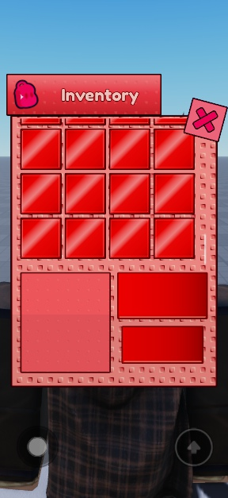 |


| Pointer left | Pointer right |

| --- | --- |

|  | 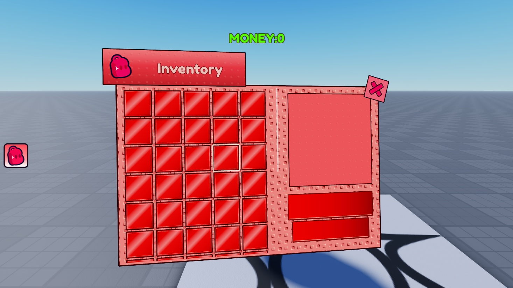 |


| Compact portrait | Compact landscape |

| --- | --- |

| 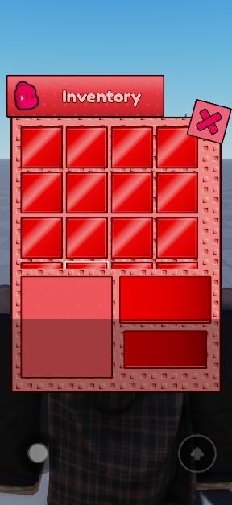 | 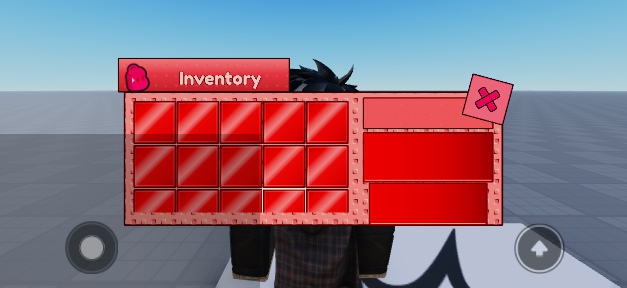 |


| Backpack hover | Left-edge cell hover |

| --- | --- |

| 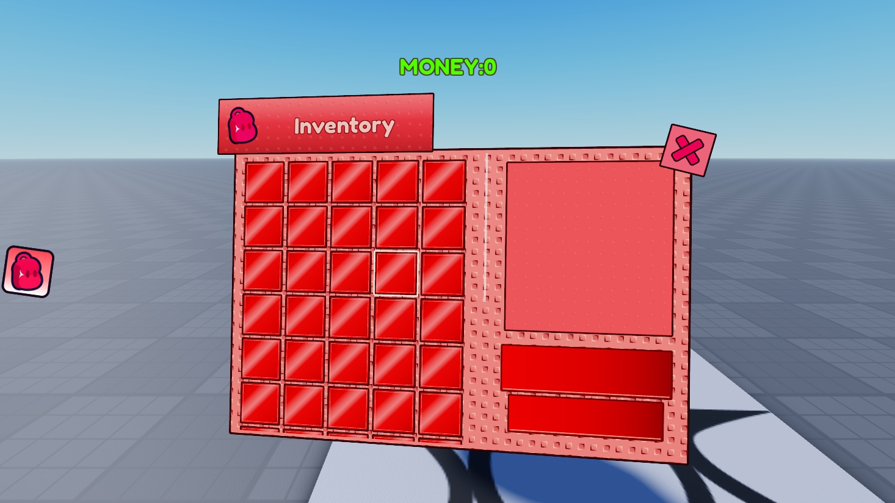 | 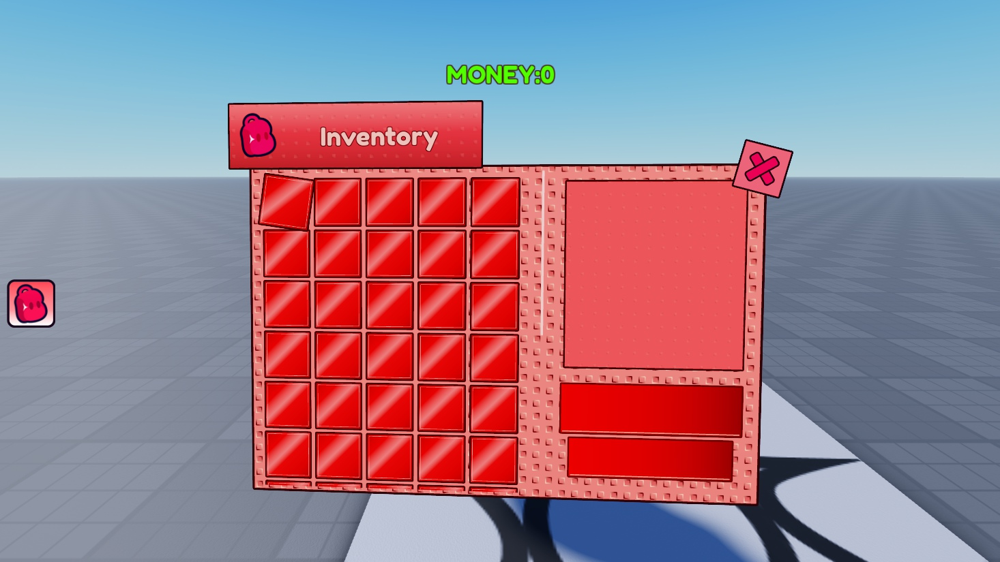 |


| Larger upper bar hover | Smaller lower bar hover |

| --- | --- |

| 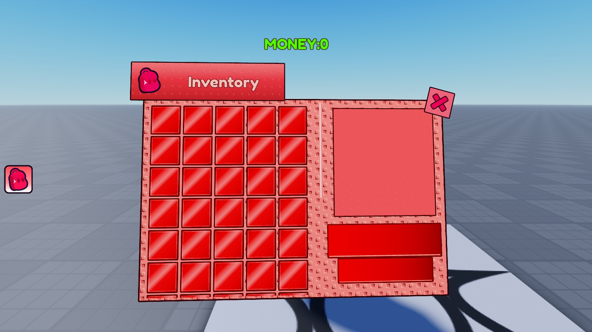 | 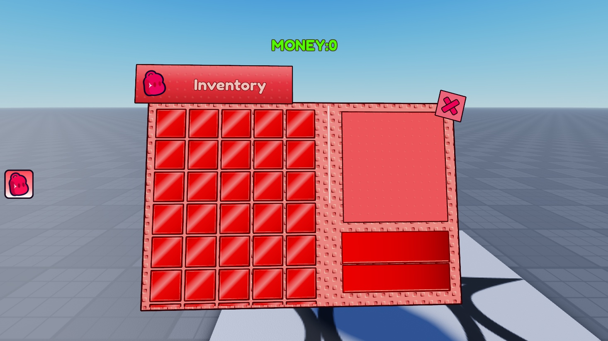 |


| Desktop grid at the bottom | White thumb / last cell |

| --- | --- |

| 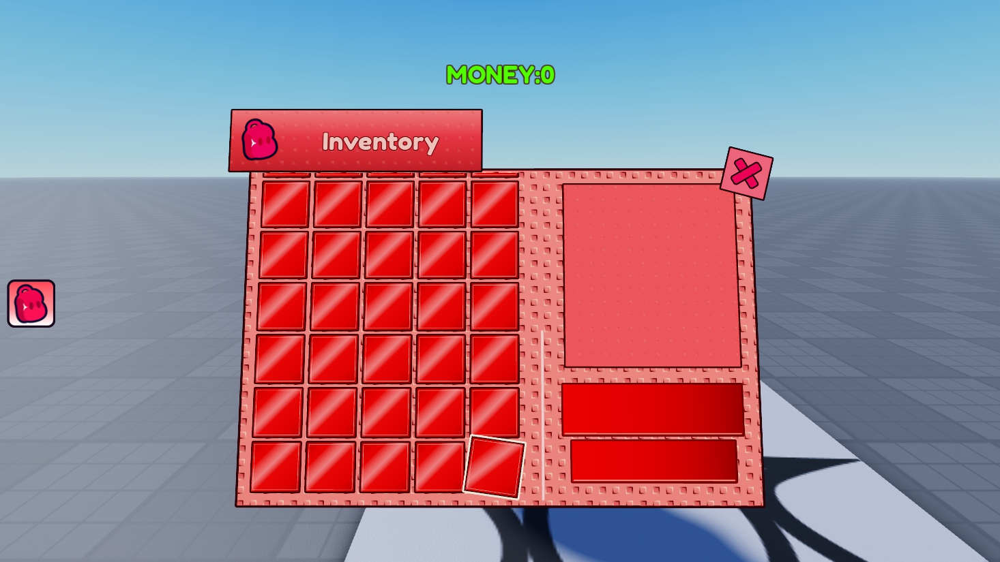 | Cell60 was reached with the real mouse wheel and selected through actual mouse input. The white thumb was also dragged. |


### Tablet


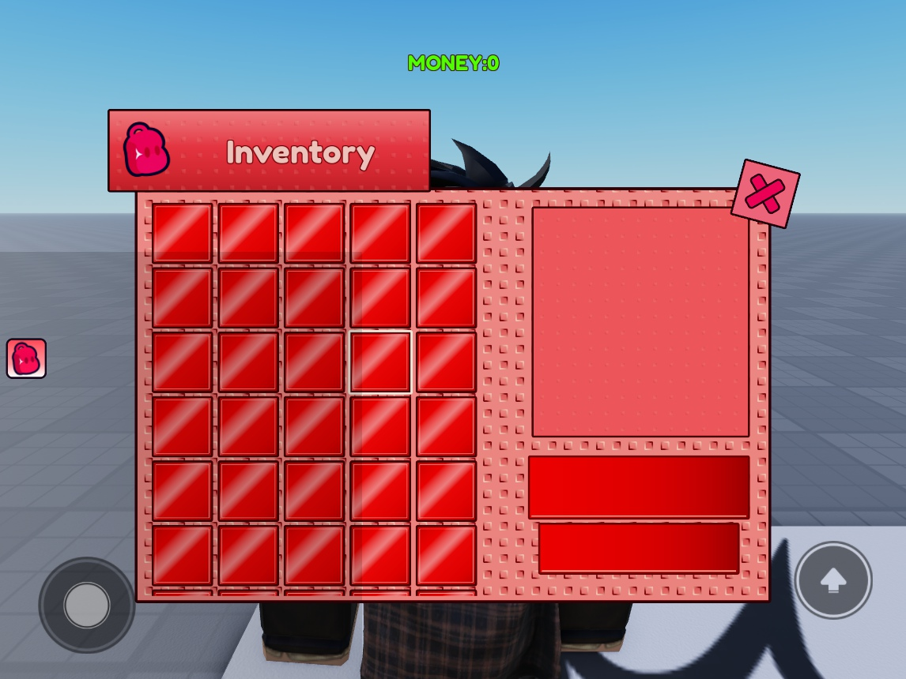


## What's in this folder?


```text

SurfaceInventory.rbxm       Actual Studio SerializationService native export

src/                       Editable XML authoring snapshot, controller and config

assets/                    Generated backpack source, real ID, prompts and provenance

previews/                  16 original Studio Client screenshots

exports/                   Native/source hashes, binary inspection, runtime/device reports

tools/

 build.py            Deterministic native-instance authoring (does not edit Studio)

 check_native.luau    Independent Lune binary/source inspector

 verify.py           Binary/source/gallery integrity checks

 Probe.client.luau    Read-only runtime projection and geometry probe

VERIFICATION.md             Actual evidence, limits, remaining issues and coverage

```


## Dependencies and verification


The model contains 12989 native instances, including 60 slots and both scripts. Studio export, independent binary/source inspection, real image loads, mouse actions, reveal/tilt, repeated input, respawn, camera replacement and teardown were exercised. **27 explicit-orientation emulator cases passed sampled geometry probes**; this is not physical-device or full touch/gamepad certification. The previous portrait-rotation warning did not reproduce in the final imported portrait -> landscape -> portrait checks, including after camera replacement and respawn. Universal physical-device acceptance is not claimed.


The previous 0.3.0 before/after native-UI round-trip regression produced **82 / 1,209,450 thresholded Pixelmatch mismatches** with no mask or resizing, using a deliberately frozen decorative loop for that static regression only. This measures appearance retention only, **not accuracy against the source videos**. Their original UI viewport/scaling is unknown; numeric source-video fidelity remains blocked. Artwork, tiny texture/outline details and exact input/easing are approximations. See [VERIFICATION.md](VERIFICATION.md).


AlwaysOnTop is false with a camera-near proxy to provide ordinary SurfaceGui rendering. Very close world geometry can still occlude it. Only the connected account's artwork access was verified. No backend, public release, reuse license, commit or push is implied. **UNLICENSED private draft.**


<details>

<summary>For pack maintainers: source builds and checks</summary>


Authoritative design: tools/build.py. Authoritative runtime: src/Controller.client.luau and src/Config.luau. Rebuilding authoring XML embeds their current text. It does not overwrite the primary Studio export automatically.


```powershell

python packs/ui/surface-inventory/tools/build.py

rojo build packs/ui/surface-inventory/src/model.project.json -o packs/ui/surface-inventory/exports/authoring.rbxm

python packs/ui/surface-inventory/tools/verify.py

```


The inspector uses Lune 0.10.5+ (`LUNE_BIN` can select it). Old Rojo 7.5 cannot decode the current Studio-native Tags representation; that is a reader limitation, not a reason to replace the Studio export with an older binary. After changes, re-export from Studio, reinsert/replay, refresh actual screenshots and matching evidence, and rerun checks. RHR is optional static triage and does not execute the actual controller.


</details>


## X-button hover correction (0.5.2)


Demo reference 14.7?15.1s: centered enlargement and click compression. Reconstructed scale 1 ? 1.12 on hover, 0.92 held, smoothly returns to 1; authored 15? tilt preserved. Exact easing/scale are reconstruction values, not calibrated source measurements.


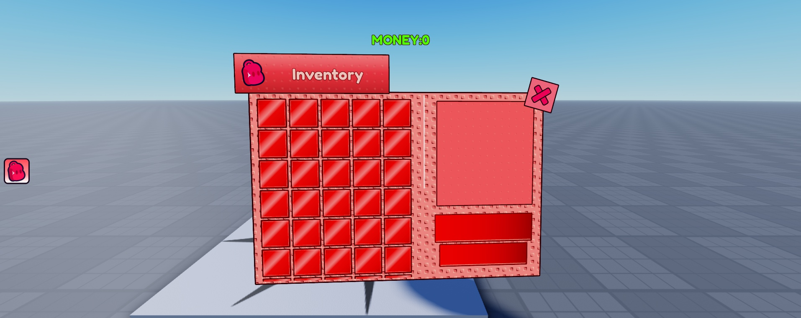


This focused update adds the close-hover capture; the previous 16 gallery states document the unchanged layout from 0.5.1.


## Close hover (0.5.2)


Demo14.7-15.1s: centered enlargement and click compression. Reconstructed hover scale1.12, held0.92, smooth return1. Exact source easing remains inferred. Existing16 gallery images show unchanged0.5.1 layout.


