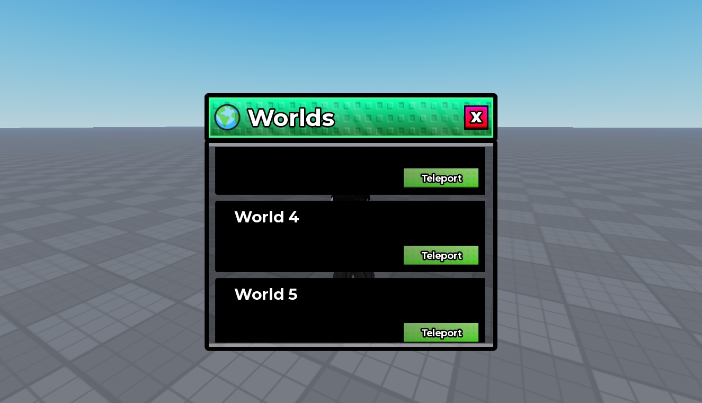

# Worlds Teleporter UI

Editable green-stud Worlds window with five world entries, a scrolling list, close control and Teleport buttons. Entry artwork areas render black in this session.

**Preview release 0.1.0.** Static layout inspected in Studio Play on temporary clones at 1325 x 761; panel visibility and scroll positions were set manually. No gameplay handlers are included. No mobile/gamepad testing. Native files are unchanged. No teleport implementation, destination IDs or world-unlock logic. Black world-artwork areas remain unresolved; no successful artwork loading is claimed.

## Download

[Download Worlds Teleporter GUI - TU.rbxm](Worlds%20Teleporter%20GUI%20-%20TU.rbxm?raw=1) — 18,570 bytes.

[Full gallery — 3 screenshots](GALLERY.md) | [Native inventory](INVENTORY.md) | [Verification](VERIFICATION.md)

## Included assets

Editable green-stud Worlds window with five world entries, a scrolling list, close control and Teleport buttons. Entry artwork areas render black in this session.

No embedded scripts were found.

## Installation

Create a ScreenGui under StarterGui and import Worlds inside it. Preview clones used AnchorPoint (0.5, 0.5) and Position (0.5, 0.5). Configure entry labels and your own artwork. Connect close/navigation controls and implement server-validated teleport destinations and unlock checks; none are supplied.

## Customization and dependencies

Work on a copy in Studio. Preserve required internal hierarchy, attachments, bones and relative transforms. Inspect [asset references](ASSET-REFERENCES.json); their availability in this Studio session does not guarantee permission in your destination experience. Keep original creator notices.

## Verification and limitations

Static layout preview in Studio Play on temporary clones; no original scripts are present. Panel visibility and scrolling were set manually, not by working navigation. Native instance counts/root names matched the supplied imports. Viewport 1325 x 761; desktop only.

Static layout inspected in Studio Play on temporary clones at 1325 x 761; panel visibility and scroll positions were set manually. No gameplay handlers are included. No mobile/gamepad testing. Native files are unchanged. No teleport implementation, destination IDs or world-unlock logic. Black world-artwork areas remain unresolved; no successful artwork loading is claimed.

SHA-256: `6b1bccf9cf3ce8be5339aa1db760866d360b4b572c0df393a26c93cdc0f5ebc4`

## Credits and license

[Credits](CREDITS.md) | [Scoped project MIT notice](LICENSE) | [Repository scope](../../../docs/LICENSING.md) | [Changelog](CHANGELOG.md)

[Back to category](../README.md)
