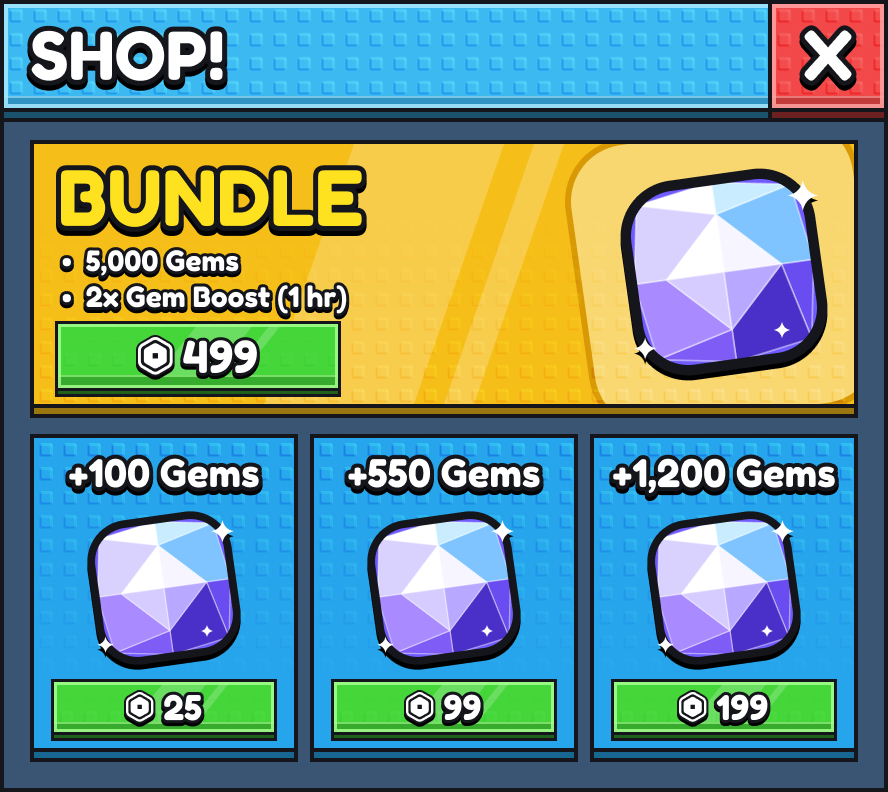

# Steal a Template / UI design resources

Artwork and editable examples for building Roblox interfaces in Figma and Roblox Studio. Browse and use the files directly here in Steal a Template.

## Included files

| Collection | Contents |
| --- | --- |
| [Kek UI Essentials](assets/kek-ui-essentials/) | Stud textures, shapes, chains, and decorative UI artwork |
| [UI Resources](assets/ui-resources/files/) | Backgrounds, textures, icons, renders, effects, and sounds |
| [Stud shop example](examples/stud-shop/) | Figma scripts, Roblox assets, and rendered previews |

## Use the resources

1. Choose artwork from the folders above. The [asset manifest](assets/ui-resources/MANIFEST.csv) identifies files and their creators.
2. Import selected images into Figma to build an editable layout. The shop example includes scripts and renders you can inspect locally.
3. For Roblox, upload the assets you have permission to use, then build the interface with editable Studio instances. Update image IDs to the uploads available to your experience.
4. Test the finished interface in Studio and capture each screen and state for its pack page.

These are design source files and examples; the ready-to-insert interfaces are in [UI kits](../../packs/ui/).

## Credits

Adapted from `grim-technologies-arch/ui-figma-roblox`, commit `99d286134d1fe9bed75e41c563f98555ac714c3c`. [Source records](UPSTREAM.json) retain the original file checksums for provenance; locally edited documentation may differ.

Original creator credits are preserved in [ATTRIBUTION.md](ATTRIBUTION.md). The [MIT license](LICENSE) covers the original code and documentation; artwork retains its individual creator terms. Check those terms before uploading or distributing an asset.
